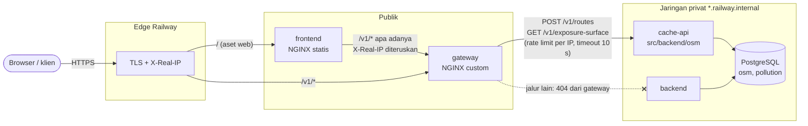

# TI-DO-05: NGINX custom untuk MVP dan routing final

Bukti verifikasi untuk [issue #28](https://github.com/ppthimmel/SIPPolusi/issues/28):
konfigurasi NGINX teredaksi, hasil uji proxy/429/timeout, dan diagram jalur
publik ke backend. Panduan operasional ada di
[`src/gateway/README.md`](../../src/gateway/README.md).

Diuji 27 Oktober 2026 (WIB) di lokal: image gateway `nginx:1.27-alpine`,
Cache API dari `src/backend/osm/Dockerfile`, PostgreSQL/PostGIS dari compose.
**Belum diuji di Railway** (lihat [Langkah di Railway](#langkah-di-railway)).

## Status acceptance criteria

| Kriteria | Status | Bukti |
|---|---|---|
| Permintaan yang diizinkan diteruskan ke backend privat dan responsnya utuh | Terpenuhi (lokal) | Uji gateway bagian 3; [uji end-to-end](#uji-end-to-end-dengan-cache-api-asli): status, body, dan `Content-Type` sama dengan Cache API langsung; satu `X-Request-ID` |
| Rate limiting mengembalikan 429 pada endpoint/skenario uji yang disepakati | Terpenuhi (lokal) | Uji gateway bagian 4; end-to-end: request ke-7 `POST /v1/routes` → 429, `Retry-After: 3` |
| Timeout dan upstream tidak tersedia menghasilkan respons gateway yang terkontrol | Terpenuhi (lokal) | Uji gateway bagian 5; end-to-end: Cache API di-*pause* → 504 setelah 10 s, dihentikan → 502 setelah ±4 s; `/healthz` tetap 200 |
| Konfigurasi final tidak membuka endpoint internal selain yang diperlukan | Terpenuhi (lokal) | Hanya `/healthz`, `POST /v1/routes`, `GET /v1/exposure-surface`; 22 jalur internal dan *near miss* → 404 dari gateway |

## Jalur publik ke backend



Urutan pemrosesan satu request di gateway:

1. **Alamat klien.** `X-Real-IP` dari edge Railway menjadi `$remote_addr`
   (modul `realip`). Edge mengisi header ini dengan alamat pemanggil dan
   mengganti salinan yang dikirim pemanggil.
2. **Pencocokan lokasi** pada path yang sudah dinormalkan. Hanya tiga lokasi
   exact match yang terbuka; selebihnya `404 not_found`.
3. **Rate limit** (`limit_req`) per alamat klien dan per path; bila terlampaui,
   `429 rate_limited` tanpa menyentuh Cache API.
4. **Batas body** 16 KiB pada `/v1/routes` (`413 payload_too_large`).
5. **Proxy** ke `CACHE_API_UPSTREAM` dengan path lokasi itu sendiri ditambah
   query string apa adanya, header `X-Request-ID` dan `X-Request-Received-At`,
   connect timeout 5 s, read/send timeout 10 s. Gagal terhubung → `502`,
   tidak menjawab → `504`.

## Konfigurasi NGINX (teredaksi)

Konfigurasi tidak memuat rahasia; satu-satunya nilai dari lingkungan adalah
alamat upstream, ditulis di sini sebagai `<CACHE_API_UPSTREAM>`. Komentar dan
direktif log diringkas; berkas lengkap:
[`src/gateway/templates/default.conf.template`](../../src/gateway/templates/default.conf.template).

```nginx
set_real_ip_from 0.0.0.0/0;
set_real_ip_from ::/0;
real_ip_header X-Real-IP;

limit_req_zone $binary_remote_addr zone=routes:10m rate=20r/m;
limit_req_zone $binary_remote_addr zone=exposure_surface:10m rate=60r/m;
limit_req_status 429;
limit_req_log_level info;

map $uri $retry_after_s {
    /v1/routes  3;
    default     1;
}

server {
    listen ${PORT};
    add_header X-Request-ID $request_id always;

    location = /healthz { return 200 '{"status":"ok","service":"gateway"}'; }

    proxy_http_version 1.1;
    proxy_set_header Connection "";
    proxy_set_header X-Request-ID $request_id;
    proxy_hide_header X-Request-ID;
    proxy_set_header X-Request-Received-At $msec;
    proxy_set_header X-Forwarded-For $proxy_add_x_forwarded_for;
    proxy_set_header X-Forwarded-Host $host;
    proxy_set_header X-Forwarded-Proto $http_x_forwarded_proto;
    proxy_connect_timeout 5s;
    proxy_send_timeout 10s;
    proxy_read_timeout 10s;

    error_page 413 = @payload_too_large;     # {"error":{"code":"payload_too_large",...}}
    error_page 429 = @rate_limited;          # + Retry-After: $retry_after_s
    error_page 502 = @upstream_unavailable;
    error_page 504 = @upstream_timeout;

    location = /v1/routes {
        limit_req zone=routes burst=5 nodelay;
        client_max_body_size 16k;
        set $cache_api_upstream <CACHE_API_UPSTREAM>;
        proxy_pass $cache_api_upstream/v1/routes$is_args$args;
    }

    location = /v1/exposure-surface {
        limit_req zone=exposure_surface burst=10 nodelay;
        set $cache_api_upstream <CACHE_API_UPSTREAM>;
        proxy_pass $cache_api_upstream/v1/exposure-surface$is_args$args;
    }

    location / { return 404 '{"error":{"code":"not_found",...}}'; }
}
```

### Keputusan desain

| Keputusan | Alasan |
|---|---|
| Hanya dua endpoint publik | Itulah yang dipanggil Frontend (kontrak TI-SE-08, `public_api/openapi.json`). `/v1/osm/*` dan `/v1/pollution/*` adalah baca internal Cache API (IRoadGraphRead, IPollutionWeightRead); endpoint inspeksi `/v1/routes/solve`, `/plan`, `/solver-input` untuk pengembang. Layanan internal menjangkaunya lewat jaringan privat (TI-DO-04). |
| `BACKEND_UPSTREAM` dihapus | Tidak ada jalur publik yang menuju Backend lagi; rute final (`POST /v1/routes`) dilayani Cache API sejak TI-SE-08. |
| Batas dari Tabel 3.15 | `/v1/routes` 20/menit, burst 5; `/v1/exposure-surface` 60/menit. Burst heatmap tidak disebut di desain; dipilih 10 agar beberapa geseran peta cepat (setelah debounce 500 ms) tidak ditolak. |
| `Retry-After` tetap per path | NGINX tidak menghitung sisa waktu; satu interval isi ulang (3 s atau 1 s) adalah waktu sampai satu request lagi pasti lolos. Diverifikasi: klien yang ditolak lolos lagi setelah 3 s. |
| `X-Real-IP` dipercaya dari peer mana pun | Rentang alamat edge Railway tidak terdokumentasi dan dapat berubah, sehingga `set_real_ip_from` sempit tidak dapat diandalkan. Di Railway gateway hanya dapat dicapai lewat edge (yang menimpa header) atau jaringan privat (Frontend, yang meneruskannya). Jangan menaruh CDN di depan gateway tanpa meninjau ini. |
| Path tetap pada `proxy_pass` | NGINX mencocokkan lokasi pada path yang sudah dinormalkan, sedangkan `proxy_pass` tanpa URI meneruskan path mentah. `/v1/osm/x/../../routes` cocok dengan `= /v1/routes`, sehingga path tetap mencegah bentuk mentahnya sampai ke Cache API. |
| `limit_req_log_level info` | Penolakan tidak ditulis ke stderr (yang memuat alamat klien); log akses tetap mencatat setiap 429 sebagai `warn` tanpa alamat klien. |
| Traefik tidak dipakai | Sesuai ruang lingkup issue; API gateway bawaan Railway hanya sebagai edge TLS. |

## Hasil uji

### Uji gateway (`tests/run.sh`, setiap build image)

```bash
docker build --target test src/gateway
```

80 pemeriksaan, 80 lulus, ±15 s. Bagian 1 (validasi variabel, 34 kasus) dan
2 (render template + `nginx -t`) tidak ditampilkan. Bagian 3–5 (badan respons
dipotong):

```
== 3. routing with a stub upstream
PASS  GET /healthz -> HTTP 200 {"status":"ok","service":"gateway"}
PASS  POST /v1/routes -> HTTP 200 cache_api /v1/routes ff65fc26601a8076a1e746240e228b44
PASS  GET /v1/exposure-surface?bbox=106.8,-6.2,106.81,-6.19&zoom=15 -> HTTP 200 cache_api /v1/exposure-surface?bbox=106.8,-6.2,106
PASS  POST /v1/osm/version/../../routes -> HTTP 200 cache_api /v1/routes 702f1a19bb5f700ea4ddbd170533311a
PASS  GET /v1/osm/x/%2E%2E/%2E%2E/exposure-surface?zoom=1 -> HTTP 200 cache_api /v1/exposure-surface?zoom=1 e70d38dd4bcfeffddb4b87
PASS  GET /v1/routes/solve -> HTTP 404 {"error":{"code":"not_found","message":"Unknown path","reque
PASS  GET /v1/routes/plan -> HTTP 404 ...
PASS  GET /v1/routes/solver-input -> HTTP 404 ...
PASS  GET /v1/routes/ -> HTTP 404 ...
PASS  GET /v1/exposure-surface/ -> HTTP 404 ...
PASS  GET /v1/osm/version -> HTTP 404 ...
PASS  GET /v1/osm/graph?mode=walk -> HTTP 404 ...
PASS  GET /v1/osm/subgraph -> HTTP 404 ...
PASS  GET /v1/pollution/windows -> HTTP 404 ...
PASS  GET /v1/pollution/edge-weights -> HTTP 404 ...
PASS  GET /v1/other -> HTTP 404 ...
PASS  GET /v1/ -> HTTP 404 ...
PASS  GET /v1 -> HTTP 404 ...
PASS  GET /health -> HTTP 404 ...
PASS  GET /health/ready -> HTTP 404 ...
PASS  GET /metrics -> HTTP 404 ...
PASS  GET /docs -> HTTP 404 ...
PASS  GET /openapi.json -> HTTP 404 ...
PASS  GET / -> HTTP 404 ...
PASS  POST /v1/routes/solve -> HTTP 404 ...
PASS  POST /v1/routes%2Fsolve -> HTTP 404 ...
PASS  GET /v1/routes/../osm/version -> HTTP 404 ...
PASS  X-Request-Received-At forwarded (1793049790.822)
PASS  POST /v1/routes -> HTTP 413 payload_too_large (JSON)
PASS  POST /v1/routes with 16 000 bytes reaches the Cache API
== 4. rate limiting (per client address)
PASS  /v1/routes: 6 quick requests from 198.51.100.7 pass (rate + burst)
PASS  POST /v1/routes -> HTTP 429 rate_limited (JSON)
PASS  429 carries Retry-After: 3 and the same wait in the message
PASS  /v1/routes: another client address is not affected
PASS  /v1/routes: the refused client passes again after Retry-After
PASS  /v1/exposure-surface?zoom=13: 11 quick requests from 198.51.100.9 pass (rate + burst)
PASS  GET /v1/exposure-surface?zoom=13 -> HTTP 429 rate_limited (JSON)
PASS  429 carries Retry-After: 1 and the same wait in the message
PASS  limits are per path: /v1/routes unaffected by the heatmap limit
PASS  /healthz: 30 quick requests all 200 (not limited)
== 5. upstream failures
PASS  POST /v1/routes -> HTTP 502 upstream_unavailable (JSON)
PASS  GET /v1/exposure-surface -> HTTP 502 upstream_unavailable (JSON)
PASS  POST /v1/routes -> HTTP 504 upstream_timeout (JSON)
PASS  504 after 10 s (proxy_read_timeout 10s)
PASS  GET /healthz -> HTTP 200 {"status":"ok","service":"gateway"}
all gateway tests passed
```

Setiap pemeriksaan galat (`expect_json_error`) juga memastikan
`Content-Type: application/json`, tepat satu `X-Request-ID`, dan `request_id`
di body sama dengan header.

### Uji end-to-end dengan Cache API asli

Compose dengan `postgres`, `cache_api`, dan `gateway`; schema `osm` dan
`pollution` dibuat dari `src/data_worker/osm_cache/schema.sql` tanpa data, jadi
Cache API menjawab dengan galatnya sendiri (`cache_unavailable`), bukan 200.
Request dari host (tanpa `X-Real-IP`, sehingga kuncinya alamat bridge Docker).

**Respons utuh.** Request yang sama langsung ke Cache API (`:8001`) dan lewat
gateway (`:8081`) menghasilkan status, `Content-Type`, dan body yang identik
kecuali `request_id` (gateway mengganti ID dengan miliknya, sama di header dan
body):

```
== direct POST /v1/routes
HTTP/1.1 500 Internal Server Error
x-request-id: 0ed483d5-5372-46cf-8601-5cb90692d706
content-type: application/json
{"error":{"code":"internal_error","message":"Terjadi galat internal pada server.","request_id":"0ed483d5-..."}}
== gateway POST /v1/routes
HTTP/1.1 500 Internal Server Error
Content-Type: application/json
X-Request-ID: 51d596590f33fd7bbe9a52bbb93eb68a
{"error":{"code":"internal_error","message":"Terjadi galat internal pada server.","request_id":"51d596590f33fd7bbe9a52bbb93eb68a"}}
== bodies identical apart from request_id?
r: same
s: same
```

(Uji ini dijalankan sebelum schema dibuat, sehingga Cache API menjawab 500.
Galat validasi dari aplikasi juga diteruskan utuh:
`400 invalid_request "preference.alpha + preference.beta harus 1 (sekarang 1.4)."`.)

**Rate limit, timeout, upstream mati:**

```
== 8 quick POST /v1/routes from the host
400 400 400 400 400 400 429 429
Retry-After: 3
{"error":{"code":"rate_limited","message":"Terlalu banyak permintaan. Coba lagi dalam 3 detik.","request_id":"8559dff2cf948f8b901bdbcb4e981d21"}}
== Cache API paused (accepts, never answers)
{"error":{"code":"upstream_timeout","message":"Layanan tidak merespons tepat waktu. Silakan coba lagi.","request_id":"5afac6f8..."}}  -> HTTP 504 after 10 s
== Cache API stopped
{"error":{"code":"upstream_unavailable","message":"Layanan sedang tidak dapat dihubungi. Silakan coba lagi.","request_id":"d1e3ee3f..."}}  -> HTTP 502 after 4 s
{"status":"ok","service":"gateway"}  -> HTTP 200
```

Log akses gateway untuk kejadian di atas (tanpa alamat klien, query string, atau
body):

```json
{"time":"2026-10-26T21:25:39+00:00","level":"warn","message":"POST /v1/routes 429","request_id":"8559dff2cf948f8b901bdbcb4e981d21","method":"POST","path":"/v1/routes","status":429,"bytes_sent":145,"duration_s":0.000,"upstream_status":"","upstream_duration_s":""}
{"time":"2026-10-26T21:25:49+00:00","level":"error","message":"GET /v1/exposure-surface 504","request_id":"5afac6f88da9b38252483a06937a8fae","method":"GET","path":"/v1/exposure-surface","status":504,"bytes_sent":153,"duration_s":10.011,"upstream_status":"504","upstream_duration_s":"10.011"}
{"time":"2026-10-26T21:25:55+00:00","level":"error","message":"GET /v1/exposure-surface 502","request_id":"d1e3ee3fc4e1c98c4120d86b2009c522","method":"GET","path":"/v1/exposure-surface","status":502,"bytes_sent":158,"duration_s":3.990,"upstream_status":"","upstream_duration_s":""}
```

**Smoke test gateway** (`scripts/smoke_test.py`, setelah schema dibuat):

```
PASS  gateway liveness               GET http://localhost:8081/healthz
PASS  route request via gateway      POST http://localhost:8081/v1/routes
      HTTP 503 12 ms {"error": {"code": "cache_unavailable", "message": "OSM Cache DB belum memiliki graph_version berstatus 'active'.", ...
PASS  heatmap via gateway            GET http://localhost:8081/v1/exposure-surface?bbox=106.822,-6.180,106.832,-6.170&zoom=15
      HTTP 503 33 ms {"error": {"code": "cache_unavailable", "message": "Spatial Pollution Cache DB belum memiliki time window berstatus complete.", ...
PASS  Cache API internals closed     GET http://localhost:8081/v1/osm/version
PASS  route inspection closed        POST http://localhost:8081/v1/routes/solve
PASS  health endpoints closed        GET http://localhost:8081/health
6/6 checks passed
```

**Koleksi uji API publik lewat gateway** (`python -m public_api.smoke --base-url
http://gateway:8080`). Koleksi ini mengirim 11 request ke `/v1/routes`
berturut-turut, melebihi burst; 429 kini ditunggu sesuai `Retry-After` lalu
dikirim ulang:

```
PASS  Body > 16 KiB → 413 payload_too_large (0.00 s)
      429 dari API Gateway, tunggu 3 s (Retry-After)
PASS  Tujuan di Kepulauan Seribu (luar wilayah studi) → 422 outside_study_area (0.00 s)
      429 dari API Gateway, tunggu 3 s (Retry-After)
FAIL  Pantai Ancol → laut (tidak dekat jalan): HTTP 503, harap [422]: {"error":{"code":"cache_unavailable",...,"reason":"cache_empty"}}
...
16/17 lulus
```

Satu kasus gagal karena butuh graf jalan Jakarta; basis data lokal ini kosong.
Kasus itu lulus terhadap data asli (TI-SE-08) dan tidak bergantung pada gateway.

### Uji Cache API

`docker build -f src/backend/osm/Dockerfile --target test` lalu jalankan:
`osm` 100 lulus, `pollution` 20, `planner` 35, `public_api` 120 (termasuk
`openapi.json` yang kini hanya memuat dua path publik dan uji retry 429 pada
koleksi uji). `solver/tests/test_cancel.py` gagal 1–2 kasus karena pewaktuan;
kegagalan yang sama terjadi pada commit sebelum perubahan ini, tidak terkait
gateway.

## Langkah di Railway

Belum dijalankan. Setelah PR digabung dan gateway di-deploy ulang:

1. Service `gateway`, Variables: pastikan `CACHE_API_UPSTREAM` =
   `http://${{cache-api.RAILWAY_PRIVATE_DOMAIN}}:${{cache-api.PORT}}`; hapus
   `BACKEND_UPSTREAM` (diabaikan bila masih ada).
2. Smoke test dari luar:

   ```bash
   python scripts/smoke_test.py --gateway https://<gateway>.up.railway.app
   ```

3. Rate limit dari satu alamat (permintaan ke-7 harus 429 dengan `Retry-After: 3`):

   ```bash
   for i in 1 2 3 4 5 6 7 8; do curl -s -o /dev/null -w '%{http_code} ' -X POST -H 'Content-Type: application/json' -d '{}' https://<gateway>.up.railway.app/v1/routes; done
   ```

4. Pastikan alamat klien dipakai sebagai kunci, bukan alamat edge: dari dua
   jaringan berbeda (misalnya laptop dan ponsel lewat data seluler), jalankan
   langkah 3 bersamaan; masing-masing harus mendapat 6 kali 400 sebelum 429.
   Bila salah satu mendapat 429 lebih awal, `X-Real-IP` tidak sampai dan
   semua klien berbagi satu kunci.
5. Tambahkan hasilnya ke dokumen ini.

## Catatan

- **Bergantung pada TI-SE-08 ([#55](https://github.com/ppthimmel/SIPPolusi/pull/55))**:
  rute final dan galat 413/502/504 berasal dari sana, dan branch ini sudah
  memuatnya. Gabungkan #55 lebih dulu.
- **TI-DO-04 ([#58](https://github.com/ppthimmel/SIPPolusi/pull/58))** menambah
  `listen [::]:${PORT}` pada template yang sama (tidak bertabrakan), tetapi
  diagram dan tabel variabelnya di `docs/devops/private-networking.md` masih
  menyebut `/v1/*` ke Backend dan `BACKEND_UPSTREAM`; perlu diselaraskan
  setelah keduanya digabung.
- **`error_log` NGINX** (hanya untuk kegagalan, mis. 502/504) memuat alamat
  klien dan baris request; dengan `X-Real-IP` alamat itu kini alamat pengguna,
  bukan alamat edge. Formatnya tetap dari NGINX; log akses tidak memuat alamat
  klien.
