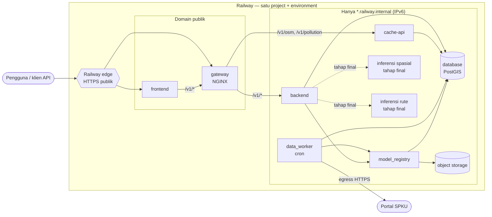

# Private networking (TI-DO-04)

Komunikasi antarlayanan SIPPolusi berjalan di jaringan privat Railway
(`*.railway.internal`), dan hanya komponen yang memang dipakai klien yang
diberi domain publik. Dokumen ini memuat diagram jaringan, konfigurasi
(teredaksi), dan prosedur uji. Hasil uji ada di
[`network-test-TI-DO-04.md`](network-test-TI-DO-04.md); build dan runtime
tiap layanan ada di [`build-runtime.md`](build-runtime.md).

## Diagram jaringan



Garis putus-putus adalah jalur tahap final yang belum ada (layanan inferensi
belum di-deploy). Arah panah adalah arah koneksi; tidak ada jalur masuk dari
internet selain lewat Railway edge ke `frontend` dan `gateway`.

## Matriks eksposur

| Komponen | Domain publik | Dipanggil oleh (privat) | Tahap |
|---|---|---|---|
| gateway | **ya** (titik masuk API) | frontend | MVP |
| frontend | **ya** (aplikasi web) | — | MVP |
| backend | tidak | gateway | MVP |
| cache-api | tidak | gateway | MVP |
| database (PostGIS) | tidak (TCP proxy dimatikan) | backend, cache-api, data_worker, model_registry | MVP |
| data_worker | tidak (cron, tanpa port) | — | MVP |
| model_registry | tidak | backend, data_worker | MVP |
| object storage | tidak | model_registry | MVP |
| inferensi spasial (`spatial-downscaling`) | tidak | backend | final |
| inferensi rute (`morl-route-policy`) | tidak | backend | final |

Observability (Prometheus, Pushgateway, Grafana) tidak termasuk cakupan
TI-DO-04.

## Aturan konfigurasi

1. **Alamat antarlayanan selalu referensi privat.** Pakai
   `${{<service>.RAILWAY_PRIVATE_DOMAIN}}` dan `${{<service>.PORT}}`, atau
   `${{database.DATABASE_URL}}` (host `postgres.railway.internal`). Jangan
   pakai `DATABASE_PUBLIC_URL`, `RAILWAY_PUBLIC_DOMAIN`, atau URL
   `*.up.railway.app` untuk komunikasi antarlayanan.
2. **Skema `http://`, bukan `https://`.** Lalu lintas privat tidak melewati
   edge Railway sehingga tidak ada TLS; jaringan privat sudah terisolasi per
   project + environment.
3. **Dengarkan IPv6.** Jaringan privat Railway memakai IPv6. Layanan yang
   dipanggil lewat jaringan privat harus mendengarkan `::`/`[::]`:
   - backend: `uvicorn host=""` (IPv4 + IPv6, `serve.py`)
   - cache-api: `uvicorn --host ""` (`osm/Dockerfile`)
   - model_registry: `mlflow server --host "[::]"` (sebelumnya `0.0.0.0`,
     hanya IPv4, sehingga tidak terjangkau dari jaringan privat)
   - gateway: `resolver ... ipv6=on` agar nama `*.railway.internal`
     terurai ke alamat IPv6.
4. **Satu environment, satu jaringan.** Jaringan privat tidak menyeberang
   antar-environment (`staging` tidak bisa memanggil `production`) atau
   antar-project.
5. **Nama internal hanya untuk dalam Railway.** Dari laptop atau CI,
   `*.railway.internal` tidak terurai. Data Worker `python main.py check`
   sudah memberi petunjuk bila hal ini terjadi.

### Variabel (teredaksi)

Nilai berikut diisi di tab Variables tiap service. Tidak ada nilai rahasia di
sini; kredensial hanya lewat referensi.

| Service | Variabel | Nilai |
|---|---|---|
| gateway | `BACKEND_UPSTREAM` | `http://${{backend.RAILWAY_PRIVATE_DOMAIN}}:${{backend.PORT}}` |
| gateway | `CACHE_API_UPSTREAM` | `http://${{cache-api.RAILWAY_PRIVATE_DOMAIN}}:${{cache-api.PORT}}` |
| frontend | `GATEWAY_UPSTREAM` | `http://${{gateway.RAILWAY_PRIVATE_DOMAIN}}:${{gateway.PORT}}` |
| backend, cache-api, data_worker | `DATABASE_URL` | `${{database.DATABASE_URL}}` |
| backend, data_worker | `MLFLOW_TRACKING_URI` | `http://${{model-registry.RAILWAY_PRIVATE_DOMAIN}}:5000` |
| backend (final) | URL layanan inferensi | `http://${{<inferensi>.RAILWAY_PRIVATE_DOMAIN}}:${{<inferensi>.PORT}}` |

Sesuaikan nama service (`cache-api`, `model-registry`) dengan nama di
dashboard. Nama variabel URL inferensi ditetapkan bersama layanan inferensi;
aturannya sama: referensi privat, `http://`, tanpa path.

## Menutup jalur publik di Railway

Untuk setiap service selain `gateway` dan `frontend`:

1. **Settings → Networking → Public Networking**: hapus domain
   `*.up.railway.app` dan domain kustom. Domain lama setelah dihapus dijawab
   edge Railway dengan `404 Application not found`
   (header `X-Railway-Fallback: true`).
2. **database**: hapus **TCP Proxy** pada Settings → Networking. Selama TCP
   proxy ada, `DATABASE_PUBLIC_URL` (`*.proxy.rlwy.net:<port>`) membuka
   PostgreSQL ke internet dengan kata sandi sebagai satu-satunya pelindung.
   Bila perlu akses dari laptop (migrasi, inspeksi), aktifkan sementara,
   catat alasannya, lalu hapus lagi dan ulangi uji di bawah.
3. Periksa tidak ada variabel yang merujuk alamat publik:
   `railway variables --service <nama> --environment <env> --kv | grep -i public`
   harus kosong untuk service yang memanggil service lain.
4. Jalankan uji jalur publik dan jalur internal di bawah, lalu catat hasilnya
   di dokumen bukti.

Untuk tahap final, layanan inferensi dibuat langsung **tanpa** domain publik
(jangan klik *Generate Domain*), dengan health check di `railway.json` dan
listen `::`.

## Prosedur uji

Alat uji: [`scripts/network_test.py`](../../scripts/network_test.py)
(pustaka standar Python saja). Setiap target diberi harapan:

- `--open TARGET`: harus terjangkau (DNS terurai, koneksi diterima, ada
  respons HTTP dari layanan).
- `--closed TARGET`: harus tidak terjangkau (nama tidak terurai, koneksi
  ditolak atau habis waktu, atau edge Railway menjawab domain yang tidak
  lagi diarahkan ke service).

Target berupa `tcp://HOST:PORT` atau `http(s)://HOST[:PORT]/PATH`. Setiap
baris hasil memuat alamat hasil DNS, sehingga hasilnya sekaligus membuktikan
DNS internal: nama internal terurai di dalam jaringan dan tidak terurai di
luar. Kode keluar 1 bila ada pemeriksaan yang gagal.

Uji routing gateway sampai layanan tetap memakai
[`scripts/smoke_test.py`](../../scripts/smoke_test.py) (tanpa `--backend`,
karena backend tidak lagi publik).

### Lokal (compose)

`docker-compose.private.yml` mencabut port host semua layanan internal,
sehingga compose meniru Railway: hanya gateway (`:8081`) dan frontend
(`:8080`) yang terbuka di host, dan nama service hanya terurai di dalam
jaringan compose.

```bash
docker compose -f docker-compose.yml -f docker-compose.private.yml up -d --build gateway

# 1. Dari host (= publik): hanya gateway yang menjawab.
python scripts/network_test.py --open http://localhost:8081/healthz \
    --closed tcp://localhost:8000 --closed tcp://localhost:8001 \
    --closed tcp://localhost:5432 --closed tcp://localhost:5000 \
    --closed tcp://localhost:9000 --closed tcp://localhost:9001 \
    --closed tcp://backend:8000 --closed tcp://postgres:5432

# 2. Dari dalam backend: jalur yang diizinkan.
docker compose exec -T backend python - --open tcp://postgres:5432 \
    --open http://cache_api:8000/health --open http://model_registry:5000/health \
    < scripts/network_test.py

# 3. Dari dalam Data Worker.
docker compose run --rm --no-deps -T data_worker python - \
    --open tcp://postgres:5432 --open http://model_registry:5000/health \
    < scripts/network_test.py

# 4. Gateway sampai backend lewat nama internal.
python scripts/smoke_test.py --gateway http://localhost:8081
```

Skrip dibaca dari stdin (`python -`), jadi tidak perlu ada di dalam image.
Port host tetap bisa dipakai untuk pengembangan dengan menjalankan
`docker-compose.yml` saja.

### Railway

Ganti `<gateway>` dan domain lama dengan nilai environment yang diuji.

```bash
# 1. Dari luar Railway (laptop/CI): jalur publik.
python scripts/network_test.py \
    --open https://<gateway>.up.railway.app/healthz \
    --open https://<frontend>.up.railway.app/ \
    --closed https://<domain-lama-backend>.up.railway.app/health \
    --closed tcp://<host-tcp-proxy-lama>.proxy.rlwy.net:<port> \
    --closed tcp://backend.railway.internal:8000 \
    --closed tcp://postgres.railway.internal:5432

# 2. Gateway sampai backend dan cache-api lewat jaringan privat.
python scripts/smoke_test.py --gateway https://<gateway>.up.railway.app

# 3. Dari dalam backend (MVP), lewat SSH ke container yang berjalan.
railway ssh --service backend --environment <env> -- python - \
    --open tcp://postgres.railway.internal:5432 \
    --open http://cache-api.railway.internal:8000/health \
    --open http://model-registry.railway.internal:5000/health \
    < scripts/network_test.py

# 4. Tahap final: backend ke kedua layanan inferensi.
railway ssh --service backend --environment <env> -- python - \
    --open http://<inferensi-spasial>.railway.internal:<port>/health \
    --open http://<inferensi-rute>.railway.internal:<port>/health \
    < scripts/network_test.py
```

Data Worker berjalan sebagai cron sehingga tidak bisa di-SSH di antara
eksekusi; jalur Worker → basis data dibuktikan oleh `python main.py check`
(host `postgres.railway.internal` di log) dan status keluar eksekusi cron.

Bila `railway ssh` tidak bisa meneruskan stdin, salin skrip ke container
(`railway ssh ... -- sh -c 'cat > /tmp/nt.py' < scripts/network_test.py`)
lalu jalankan `python /tmp/nt.py ...`.

### Layanan tidak tersedia

| Skenario | Cara | Harapan |
|---|---|---|
| Backend mati | hentikan/redeploy backend | gateway menjawab 502 dalam ±4 s (`proxy_connect_timeout 5s`), log akses `"level":"error"`, `/healthz` tetap 200 |
| Backend kembali dengan IP baru | redeploy backend | gateway pulih tanpa restart (DNS diurai ulang tiap 10 s) |
| Basis data mati | hentikan database | backend `/health` 200, `/health/ready` 503 `{"database":"unavailable"}`; Worker `check` gagal dengan nama host |
| Layanan inferensi mati (final) | hentikan layanan inferensi | backend memakai baseline dengan status fallback eksplisit (`route_source: fallback`), bukan 5xx |

## Kriteria penerimaan

| Kriteria | Bukti |
|---|---|
| Jalur internal tidak memerlukan endpoint publik | variabel memakai referensi privat; uji 2–3 lulus tanpa domain publik backend |
| Backend memanggil inferensi final lewat jaringan privat | uji Railway nomor 4 (menunggu layanan inferensi) |
| Komponen non-publik tidak dapat diakses dari jalur publik | uji 1 (`--closed`) lulus |
| Bukti uji mencakup jalur diizinkan dan ditolak | [`network-test-TI-DO-04.md`](network-test-TI-DO-04.md) |
