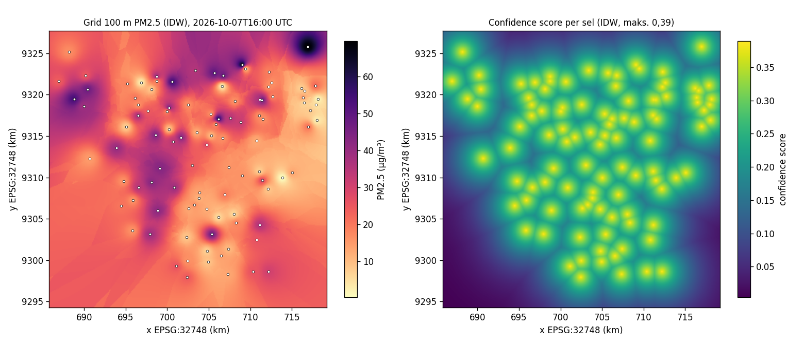
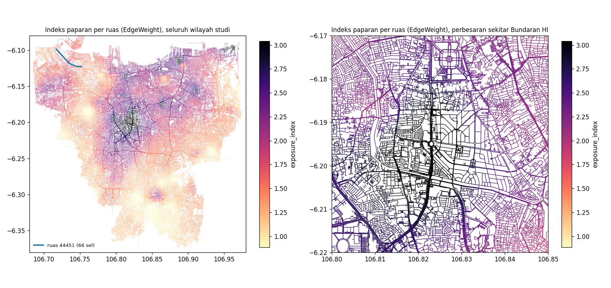

# TI-AI-05: Estimasi grid sampai EdgeWeight

## Model sistem

PM2.5 memakai **IDW + koreksi ST-GNN**; NO₂ memakai **LightGBM seluruh fitur**.
Training Python dan notebook memakai implementasi yang sama, dataset ds-v0.3.0, dan bundle
terversi MLflow dengan payload MinIO. [Panduan training/inference](../../../src/data_worker/spatial_model/README.md).
Agregasi dan cache di bawah merupakan bukti historis IDW; verifikasi model terdaftar dilaporkan terpisah.

Optimasi pembacaan sumber antar-tile dan hasil verifikasi kesetaraan fitur:
[`source_reader_cache.md`](source_reader_cache.md).

## Perbandingan ds-v0.3.0

RMSE dalam µg/m³; seluruh angka berikut berasal dari [laporan eksperimen](../model-comparison-ds-v0.3.0/README.md),
sesuai tabel laporan tahap 1. Hasil baru tidak menggantikan angka historis ini.

| PM2.5 | Metode | RMSE | R² |
|---|---|---:|---:|
| Fixed split (689 observasi) | IDW | 18.745 | 0.141 |
| Fixed split | IDW + XGBoost | 18.478 | 0.165 |
| Fixed split | IDW + ST-GNN | 18.372 | 0.175 |
| LOSO (4358 observasi; 95 fold) | IDW | 23.995 | -0.040 |
| LOSO | IDW + XGBoost | 23.288 | 0.021 |
| LOSO | IDW + ST-GNN | 23.740 | -0.018 |

| NO₂ LOSO, fitur interpolasi | RMSE | R² |
|---|---:|---:|
| IDW | 46.992 | 0.141 |
| Ridge | 41.307 | 0.336 |
| MLP | 42.027 | 0.313 |
| IDW p=1 + LightGBM | 42.644 | 0.292 |
| Ensemble 6 model | 42.778 | 0.288 |
| XGBoost | 46.449 | 0.160 |
| Random forest | 46.643 | 0.153 |
| Extra trees | 47.214 | 0.133 |
| LightGBM | 48.179 | 0.097 |

| NO₂ LOSO, fitur lengkap | RMSE | R² |
|---|---:|---:|
| IDW | 46.992 | 0.141 |
| IDW + ST-GNN | 47.168 | 0.134 |
| LightGBM | 27.429 | 0.707 |
| Random forest | 31.312 | 0.618 |
| XGBoost | 34.820 | 0.528 |
| Extra trees | 38.428 | 0.425 |
| MLP | 65.938 | -0.692 |
| Ridge (IDW + geometri sensor) | 69.979 | -0.906 |

ST-GNN adalah pilihan implementasi PM2.5; bukti tidak menunjukkan superioritas konsisten terhadap
interpolator yang disetel. Perbandingan fitur lengkap antararsitektur tidak memakai representasi identik.
NO₂ LightGBM memprediksi konsentrasi langsung; keuntungan terutama terkait fitur geometri sensor dan
perlu verifikasi bias LCS sebelum klaim generalisasi grid. Confidence masih provisional.

## Bukti grid-ke-ruas historis

Bukti verifikasi isu #16. Kode dan definisinya:
[`src/data_worker/spatial_model`](../../../src/data_worker/spatial_model/README.md).

## Cara bukti ini dibuat

- **Data masukan:** ground truth SPKU dan graf road network aktif `jakarta-20261005` (373.352 ruas),
  dibaca read-only dari PostgreSQL Railway pada 7 Oktober 2026.
- **Cache tujuan:** salinan lokal PostgreSQL 16 + PostGIS 3.4 dengan skema dari `database/models.py`
  (Tabel 3.17). Railway tidak ditulisi.
- **Yang dijalankan:** langkah siklus `trigger_downscale_inference` di `acquisition.py`, persis seperti
  cron Railway, dengan `DOWNSCALE_WRITE_CACHE=1` dan `DOWNSCALE_KEEP_WINDOWS=2`. Time window yang
  dipakai: 7 Oktober 2026 pukul 14.00, 15.00, dan 16.00 UTC.
- **Commit kode:** `e04c4aa`, working tree bersih.

| Berkas | Isi |
|---|---|
| [`run_manifest.json`](run_manifest.json) | Manifest run 16.00 UTC: versi model, alasan fallback, GridSpec, parameter IDW, hash masukan dan setiap artefak, commit |
| [`cycle_smoke.json`](cycle_smoke.json) | Hasil tiga siklus, pemanggilan ulang, flag nonaktif, dan retensi |
| [`cache_compatibility.json`](cache_compatibility.json) | Uji tulis-baca cache pada volume penuh |
| [`edge_weights_sample.csv`](edge_weights_sample.csv) | 201 contoh EdgeWeight (kolom kontrak Tabel 3.3 ditambah `n_cells` dan jarak stasiun) |
| [`grid_prediction_sample.csv`](grid_prediction_sample.csv) | 200 contoh sel grid 100 m beserta confidence score |
| [`trace_edge_44451.csv`](trace_edge_44451.csv) | Jejak satu ruas sampai sel grid sumbernya |
| [`ground_truth_input.csv`](ground_truth_input.csv) | Ground truth masukan time window 16.00 UTC setelah kendali mutu |
| [`summary_statistics.json`](summary_statistics.json) | Statistik grid, EdgeWeight, dan tabel potongan ruas-sel |

Artefak penuh per run (`grid_prediction.parquet`, `edge_cell_pieces.parquet`, `edge_weights.parquet`,
sekitar 30 MB) tidak di-commit. SHA-256 setiap berkas tercatat di `run_manifest.json`, dan seluruh artefak
dapat dibangkitkan ulang dengan `python -m spatial_model infer`.

## Contoh keluaran

**Grid 100 m (time window 7 Oktober 2026 16.00 UTC).** Masukannya 104 stasiun PM2.5 dan 11 stasiun NO2.

| | Sel | Rerata | Median | Min | Maks |
|---|---|---|---|---|---|
| PM2.5 (µg/m³) | 111.556 | 23,74 | 22,99 | 0,27 | 69,57 |
| NO2 (µg/m³) | 111.556 | 37,90 | 32,34 | 10,82 | 106,48 |
| Indeks paparan | 111.556 | 1,55 | 1,37 | 0,75 | 3,52 |
| Confidence score | 111.556 | 0,20 | 0,22 | 0,004 | 0,389 |
| Jarak ke stasiun terdekat (m) | 111.556 | 2.523 | 1.728 | 6 | 13.604 |

**EdgeWeight.** 372.069 ruas mendapat estimasi, atau 99,66% dari 373.352 ruas graf. Sisanya, 1.283 ruas,
berada di Kepulauan Seribu dan pulau-pulau Teluk Jakarta di luar grid wilayah studi. Ruas-ruas ini
dicatat di `edges_without_estimate`.

| | Ruas | Rerata | Median | Min | Maks |
|---|---|---|---|---|---|
| PM2.5 (µg/m³) | 372.069 | 23,68 | 22,40 | 0,27 | 69,57 |
| NO2 (µg/m³) | 372.069 | 45,22 | 46,02 | 10,82 | 106,48 |
| Indeks paparan | 372.069 | 1,69 | 1,60 | 0,75 | 3,52 |
| Confidence score | 372.069 | 0,27 | 0,27 | 0,05 | 0,389 |
| Sel yang dilalui | 372.069 | 1,5 | 1 | 1 | 66 |

## Definisi agregasi

Setiap ruas dipotong tepat pada batas sel grid. Nilai ruas adalah rata-rata nilai sel yang dilalui,
dibobot panjang potongan ruas di setiap sel. Indeks paparan dihitung setelah agregasi dari polutan yang
tersedia. Rinciannya ada di
[README modul](../../../src/data_worker/spatial_model/README.md#definisi-agregasi-grid-ke-ruas) dan
diuji oleh UT-SDM-07 (a)–(e).

Pada time window ini, tabel potongan memuat 574.809 pasangan ruas-sel dengan panjang total 17.317 km,
dan menyentuh 63.413 sel. Ruas yang melintasi lebih dari satu sel tertangani dengan bobot panjang.
Contohnya ruas 44451 (4,9 km) yang melintasi 66 sel: PM2.5 yang dihitung ulang dari
`trace_edge_44451.csv` adalah 25,8005 µg/m³, sama persis dengan nilai di cache.

## Metadata model dan penanda fallback

- **Model:** `model_version = idw-p2-k8` dan `estimation_source = idw`, dengan
  `fallback_reason = ModelUnavailableError: model spatial-downscaling production belum terdaftar di Model Registry`.
- **Penanda fallback:** `background_source` kosong untuk seluruh baris, karena IDW tidak memakai suku
  latar. Confidence score maksimum 0,389, sehingga seluruh ruas berkategori keyakinan rendah (< 0,4).
- **Penelusuran:** parameter IDW (power 2, 8 tetangga), hash konfigurasi baseline, GridSpec, hash ground
  truth masukan, dan versi graf tercatat di `run_manifest.json`.

## Uji kompatibilitas cache

| Pemeriksaan | Hasil |
|---|---|
| Tulis 372.069 EdgeWeight dalam satu transaksi | Berhasil; `pollution_window` berstatus `complete`, cakupan 0,9966 |
| Baca ulang seluruh wilayah studi (`read_pollution_weight`) | 372.067 baris, 2,8 s. Selisih terhadap nilai yang dihitung ≤ 7,6·10⁻⁶ (presisi `REAL`). Dua ruas tidak terbaca karena berada di dalam grid tetapi di luar bbox kueri |
| Baca bbox ±1 × 1 km (permintaan rute) | 1.178 ruas, 0,25 s pada kueri pertama |
| Tulis ulang time window yang sama | 372.069 baris, tanpa duplikat (kunci `edge_id`, `time_window_start`) |
| Tiga siklus berturut-turut | Masing-masing ±9 s; retensi menyisakan dua time window terakhir |
| Pemanggilan ulang time window yang sudah complete | `skipped`, `run_id` sama, 0 baris ditulis (UT-SDM-01b) |
| `DOWNSCALE_WRITE_CACHE` tidak diatur | Langkah berstatus `disabled` |
| Ukuran satu time window | ±92 MB termasuk indeks |

Uji otomatis pada `tests/test_spatial_edgeweight.py` dan `tests/test_spatial_baseline.py`
(UT-SDM-01, 06, 07, 08; UT-OPS-01, 02; retensi; portabilitas encoding) lulus terhadap
PostgreSQL + PostGIS sungguhan: 129 lulus. Tanpa basis data: 92 lulus dan 37 dilewati.

## Kesesuaian dengan basis data Railway

Basis data Railway menjalankan image `postgis/postgis:18-3.6` (PostgreSQL 18.6, PostGIS 3.6.4), bukan
PostgreSQL 16 seperti pada dokumen desain, `docker-compose.yml`, dan fixture uji. Seluruh 129 uji dan tiga
siklus di atas diulang pada image yang sama persis (amd64), dan semuanya lulus dengan hasil yang sama.

| Sumber daya layanan `database` (8 Oktober 2026) | Nilai |
|---|---|
| Batas CPU dan memori | 1 vCPU; 4 GB, pemakaian puncak 1 jam terakhir 307 MB |
| Volume | 5.000 MB (batas efektif 4,88 GB), terpakai 1,34 GB |
| Isi volume | Data ±0,39 GB (`osm` 252 MB, `ground_truth` 115 MB), WAL ±0,72 GB, sisanya berkas sistem |
| `max_wal_size` | 1 GB |

Simulasi sepuluh siklus per jam pada PostgreSQL 18 dengan retensi 6 time window dan VACUUM di antara siklus
(setara autovacuum) menunjukkan `edge_pollution` mendatar di ±0,67 GB. Setiap siklus menghasilkan
170–430 MB WAL, yang didaur ulang dalam batas `max_wal_size`. Proyeksi isi volume setelah flag aktif:

| Komponen | Perkiraan |
|---|---|
| Data selain cache | ±0,4 GB, bertambah sekitar 5–8 MB per hari dari ground truth |
| `pollution.edge_pollution` (retensi 6) | ±0,7–0,9 GB, tergantung jarak antar-autovacuum |
| WAL | ±1,0–1,2 GB |
| Berkas sistem | ±0,2 GB |
| **Total** | **±2,3–2,7 GB dari 4,88 GB (sekitar 50–55%)** |

Satu node PostgreSQL + PostGIS cukup untuk ground truth, graf road network, dan cache EdgeWeight
sekaligus, dengan sisa sekitar 2 GB.

## Pemenuhan acceptance criteria historis

| Kriteria | Bukti |
|---|---|
| Setiap EdgeWeight dapat ditelusuri ke versi model, input waktu, dan sel grid sumber | `model_version`, `time_window_start`, dan `graph_version` pada setiap baris cache; `run_manifest.json`; `trace_edge_44451.csv` |
| Nilai fallback dapat dibedakan dari estimasi berbasis data lengkap | `estimation_source = idw`, confidence < 0,4, `background_source` kosong, `fallback_reason` |
| Agregasi menangani ruas yang melintasi lebih dari satu sel | Pemotongan pada batas sel dengan bobot panjang; UT-SDM-07b dan 07e; ruas 44451 (66 sel) |
| Kompatibel dengan kontrak TI-SE-01 dan dapat ditulis/dibaca melalui cache | `contracts.EdgeWeight` (Tabel 3.3); tabel uji di atas; UT-OPS-01 dan 02 |

Tabel di atas menjelaskan bukti IDW historis. Untuk kontrak aktif, lihat verifikasi provenance
27 Oktober 2026 di bawah; berkas lokal historis tidak menjamin trace untuk semua window operasional.

## Keterbatasan

- **Integrasi model:** Worker memakai MLflow/MinIO bila versi dan input tersedia; kegagalan per polutan jatuh ke IDW dengan provenance eksplisit.
- **Spesifikasi sumber direvisi.** [Spesifikasi aktif](../../SPATIAL_MODEL_SPEC.md) memakai
  GEOS-CF sebagai fitur pelatihan dan operasi. Tidak ada pergantian AOD/MERRA-2 atau komponen
  aditif setelah prediksi; `background_source` kosong sesuai kontrak tersebut.
- **Confidence score provisional.** Rumusnya masih provisional sampai kalibrasi PF-12 dilakukan.
- **Kontrak TI-SE-01 belum resmi.** `EdgeWeight` mengikuti Tabel 3.3 karena TI-SE-01 belum
  menghasilkan kontrak bersama; Backend perlu memakai struktur yang sama.
- **Retensi dan deployment.** Artefak lokal tetap opsional; trace baru disimpan di PostgreSQL
  selama window cache dipertahankan. Upgrade Railway memerlukan migrasi dan verifikasi deployment
  terpisah; replay lokal tidak membuktikan bahwa deployment tersebut sudah dilakukan.

## Verifikasi integrasi model terdaftar (26 Oktober 2026)

[registered_verification.json](registered_verification.json) mencatat replay lokal dengan model
terlatih, registrasi MLflow, payload MinIO, pengunduhan cache baru, inferensi dua polutan,
agregasi ruas yang melintasi dua sel, penulisan PostGIS, dan pembacaan melalui repository backend.
Pemanggilan ulang input/versi yang sama menghasilkan `skipped`. Metadata per ruas membedakan sumber
kedua polutan. Ini verifikasi fungsi integrasi pada grid kecil, bukan evaluasi akurasi seluruh kota
atau bukti deployment Railway.

Training ulang PM2.5 CPU (seed 42, validation memilih epoch 1) menghasilkan RMSE fixed-split test
18.346 µg/m³ dibanding IDW 18.745 pada 689 pasangan yang sama. Angka ini run baru, terpisah dari
hasil historis pada tabel di atas. LightGBM memakai 4.6.0 untuk kompatibilitas native Windows;
konfigurasi full-feature direct tetap mengikuti pemilihan validation yang terdokumentasi.

Pembersihan dokumentasi dataset mengubah label provenans teks dan checksum terkait. Seluruh
13 berkas Parquet pada manifest ds-v0.3.0 diverifikasi identik dengan hash sebelum perubahan;
observasi, fitur, split dan aturan eksklusi data tidak direlabel atau dibangun ulang.

Uji akhir lokal: **210 test Data Worker** dan **31 test pollution API/cache flow** lulus.
Migrasi aditif diuji dua kali pada tabel tanpa kolom metadata dan mempertahankan konsentrasi historis.
Satu pembacaan laporan pada test baseline diperbaiki agar eksplisit UTF-8 di Windows.
Model terdaftar pada stack verifikasi lokal menggunakan versi 5 untuk kedua polutan; deployment
Railway tidak dijalankan.

## Penutupan gap provenance 27 Oktober 2026

Setiap penulisan cache baru melalui Worker wajib memiliki `InferenceTrace` yang dapat
merekonstruksi nilai ruas. Tabel `inference_run`, `grid_prediction`, dan `edge_cell` disimpan
dalam transaksi yang sama dengan `edge_pollution`; setiap bobot memiliki `trace_run_id`.
Trace memuat GridSpec, awal/akhir waktu, versi model per polutan, fingerprint input,
konfigurasi, nilai sel, sumber, dan panjang potongan. Perubahan model/input/graf atau kebijakan
trace/confidence mengubah identitas cache. Run ID yang sama tidak menerima trace berbeda.

[provenance_verification.json](provenance_verification.json) membuktikan model nyata dari
MLflow/MinIO → grid dua sel → ruas multisel → PostGIS → backend, dengan artefak lokal dimatikan.
Nilai yang dihitung ulang dari sel dan panjang pada trace cocok dengan nilai cache pada toleransi
presisi penyimpanan. Endpoint `GET /v1/pollution/edge-weights/{edge_id}/trace` menyediakan jejaknya.
Uji mencakup rollback cache/trace, retensi, pengulangan, penolakan trace salah, dan pembacaan
historis tanpa trace. Tidak dibuat riwayat sintetis untuk baris lama.

Ruang lingkup lokal TI-AI-05 mengikuti [spesifikasi revisi](../../SPATIAL_MODEL_SPEC.md).
Confidence tetap provisional; ketelitian grid seluruh kota, kalibrasi, UI, dan deployment Railway
tidak disimpulkan dari bukti replay ini.
