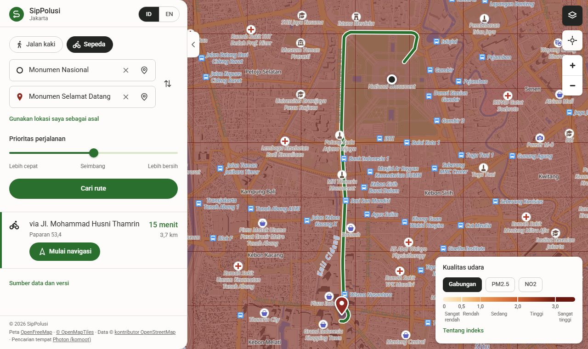
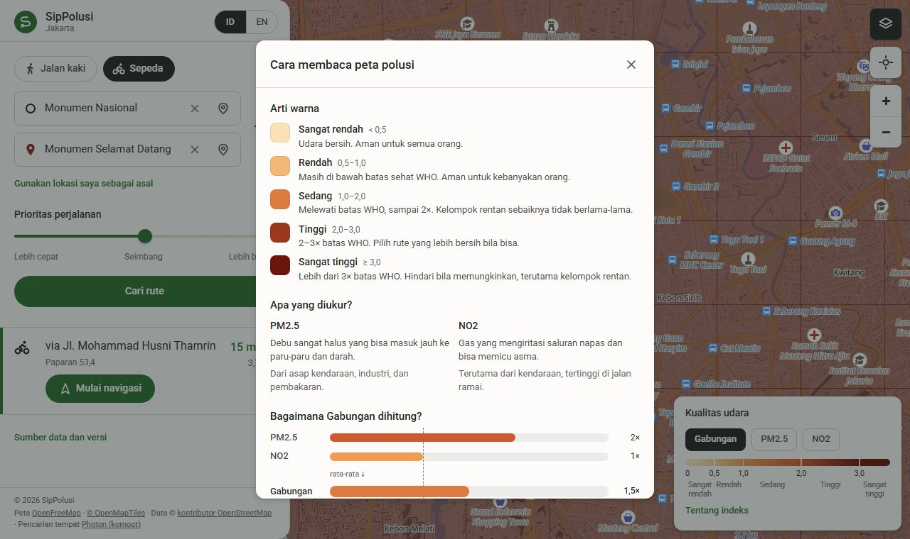
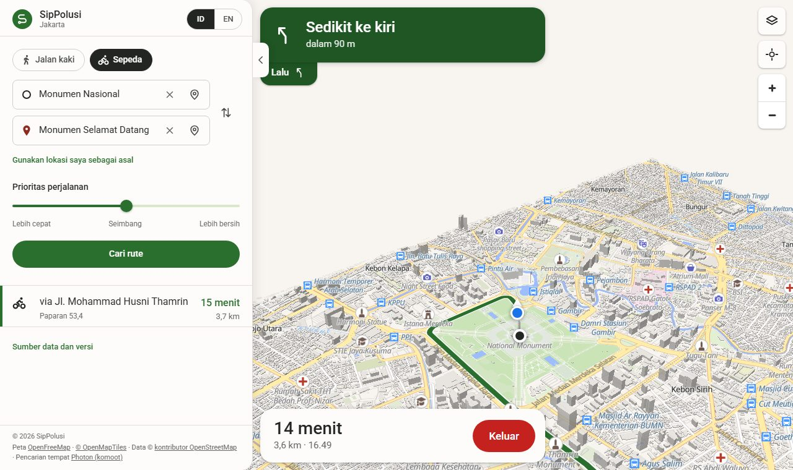
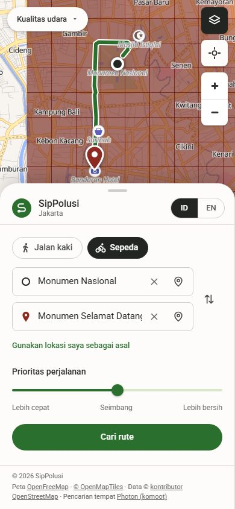
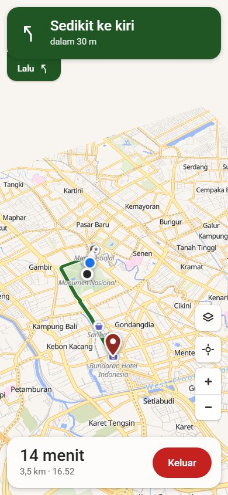

# Frontend Enhancement (issue #113)

Perbaikan UI/UX antarmuka rute ([issue #113](https://github.com/ppthimmel/SIPPolusi/issues/113)): copywriting,
penyajian status pemrosesan, tampilan, dan responsivitas mobile. Branch `frontend-enchancement`: bagian 1–9 untuk
commit `647338e`; bagian 10 untuk putaran berikutnya (commit `31decc3` dan sesudahnya), yang juga mengganti
beberapa hal di bagian 1–9 (ditandai *diganti, lihat 10.x*).

Dokumen ini mencatat setiap perubahan beserta alasannya. Kontrak API tidak berubah (`POST /v1/routes`,
`GET /v1/exposure-surface`, `/v1/geocode/*`); `contract.test.ts` tetap lulus, dan Backend tidak disentuh.

**Prinsip yang dipakai**

1. **Satu hal penting per layar.** Yang tidak dibutuhkan untuk mengambil keputusan rute disembunyikan atau
   dilipat, bukan dihapus dari aplikasi.
2. **Bahasa sehari-hari.** Pesan menyebut apa yang terjadi dan apa yang bisa dilakukan, tanpa istilah teknis
   atau kode server.
3. **Pola yang sudah dikenal.** Tata letak daftar rute, tombol hapus, dan pemilih moda mengikuti aplikasi peta
   yang umum dipakai, supaya pengguna tidak perlu belajar ulang.
4. **Aksesibilitas tidak dikorbankan.** Teks yang dihilangkan dari layar tetap tersedia untuk pembaca layar
   bila ia satu-satunya petunjuk; target sentuh mengikuti WCAG.

---

## 1. Dua bahasa: Indonesia dan Inggris

**Perubahan.** Tombol **ID | EN** di kepala panel. Semua teks antarmuka tersedia dalam dua bahasa, termasuk label
untuk pembaca layar, pesan galat, petunjuk navigasi, dan legenda. Pilihan disimpan di peramban (`localStorage`)
dan layar langsung digambar ulang tanpa memuat ulang; rute, hasil, dan navigasi yang sedang berjalan tetap.
Format angka dan jam ikut bahasa: `34,8` / `12.00 WIB` (ID) dan `34.8` / `12:00 WIB` (EN).

**Alasan.** Pengguna Jakarta tidak semuanya berbahasa Indonesia (pekerja dan pelajar asing, wisatawan), dan
dokumen penelitian ditinjau juga dalam bahasa Inggris. Bahasa Indonesia tetap bawaan.

**Batasan.** Teks yang dikirim Backend (pesan galat server, `metadata.disclaimer`) tampil apa adanya. Pesan galat
yang tampil ke pengguna kini ditulis Frontend sendiri (lihat bagian 5), jadi hal ini jarang terlihat.

**Berkas.** [`i18n.ts`](../../src/frontend/src/i18n.ts) (fungsi `tr("indo", "english")`, atribut `data-en` di
`index.html`), pemanggilan `tr()` di semua modul tampilan.

## 2. Tampilan umum

| Perubahan | Alasan |
|---|---|
| Font Roboto untuk seluruh antarmuka; warna kertas hangat dan hijau tua dipertahankan (*palet diganti, lihat 10.2*) | Satu keluarga huruf yang mudah dibaca di layar kecil. Palet lama sudah menjadi identitas aplikasi dan hijau dekat dengan makna "udara bersih" |
| Pemilih moda (Jalan kaki / Sepeda) menjadi tombol pil di atas kolom asal-tujuan | Moda menentukan rute; meletakkannya paling atas seperti panel arah pada aplikasi peta membuat urutan isian alami: moda → dari → ke |
| Simbol titik di dalam kolom: lingkaran gelap untuk asal, pin merah tua untuk tujuan; label "Asal/Tujuan" hanya untuk pembaca layar | Warna dan bentuknya mengikuti penanda di peta (titik gelap, pin merah tua), jadi kolom dan penanda terhubung tanpa teks tambahan |
| Judul "Mau ke mana?" dan teks pengantar disembunyikan dari layar (tetap ada untuk pembaca layar sebagai judul utama halaman) | Panel lebih pendek; isian langsung terlihat tanpa menggulir, terutama di ponsel |
| Penanda asal dan tujuan di peta serta garis rute memakai warna palet yang sama | Konsisten antara panel, legenda, dan peta |

**Berkas.** [`style.css`](../../src/frontend/src/style.css), [`index.html`](../../src/frontend/index.html).

## 3. Isian titik asal dan tujuan

| Perubahan | Alasan |
|---|---|
| Tombol **×** di dalam kolom, muncul hanya bila kolom berisi | Menghapus isian tanpa memilih-hapus teks satu per satu, terutama di ponsel |
| Tombol × berukuran sentuh 44 × 44 px; ikon tetap kecil | WCAG 2.5.5. Ukuran sebelumnya (36 px) lolos batas minimum AA tetapi mudah meleset |
| Tombol × punya nama untuk pembaca layar ("Hapus titik asal"), bisa dicapai dengan Tab, dan mengembalikan kursor ke kolom | Mengikuti pola tombol hapus yang aksesibel (Scott O'Hara, eBay, Atlassian) |
| **Escape** mengosongkan kolom bila daftar saran tertutup; bila terbuka, Escape hanya menutup daftar | Pola combobox WAI-ARIA: Escape menutup popup dulu, mengosongkan isian sebagai langkah opsional berikutnya |
| Galat tidak lagi berkedip saat titik dipilih lewat klik peta | Klik peta memindahkan fokus dari kolom sesaat sebelum titik terisi, sehingga kolom sempat dinilai "kosong". Pindah ke peta atau ke tombol milik kolom itu kini tidak dihitung sebagai meninggalkan kolom; pindah ke kolom lain tetap memeriksa |
| Placeholder "Cari tempat atau klik peta"; petunjuk "ketik koordinat lat, lon" dihapus dari semua pesan | Hampir tidak ada pengguna yang mengetik koordinat. Mengetik koordinat tetap berfungsi, hanya tidak diiklankan |
| Petunjuk "Lengkapi titik asal dan tujuan…" di bawah tombol dihapus | Tombol **Cari rute** sudah nonaktif sampai kedua titik valid, dan galat tampil di kolom masing-masing; petunjuk itu mengulang informasi yang sama |
| Petunjuk "Klik peta untuk memilih titik asal." disembunyikan dari layar, tetap dibacakan pembaca layar | Pengguna yang melihat memahami dari kursor dan penanda; pengguna pembaca layar tidak punya isyarat lain |

**Berkas.** [`main.ts`](../../src/frontend/src/main.ts) (bagian form), [`validation.ts`](../../src/frontend/src/validation.ts),
[`place-combobox.ts`](../../src/frontend/src/place-combobox.ts).

## 4. Status pemrosesan

| Perubahan | Alasan |
|---|---|
| Saat mencari, tombol **Cari rute** menjadi nonaktif dan berisi spinner; baris "Menghitung rute… maksimal 12 detik" dihapus | Status tampil di tempat pengguna baru saja menekan, dan tombol yang nonaktif mencegah pencarian ganda. Batas 12 detik adalah detail teknis yang tidak membantu keputusan |
| "Mencari rute…" tetap diumumkan ke pembaca layar lewat region `aria-live` | Spinner saja tidak terbaca oleh pembaca layar |
| Tombol **Batalkan** tetap ada selama pencarian | Pengguna bisa berhenti bila salah memilih titik |

## 5. Pesan galat

**Perubahan.** Galat dibagi dua:

- **Masalah di sisi sistem** (server mati, waktu habis, data kualitas udara belum tersedia, respons tak terbaca,
  5xx): satu pesan umum, "**Rute belum dapat dicari.** Terjadi kendala saat mencari rute. Coba lagi beberapa saat lagi."
- **Masalah yang bisa diperbaiki pengguna:** hanya langkahnya, misalnya "Geser titik tujuan ke dekat jalan yang
  bisa dilalui", "Pilih titik di dalam wilayah Jakarta", "Coba pindahkan titik atau ganti moda perjalanan".
  Terlalu banyak pencarian: "Tunggu 30 detik, lalu coba lagi."

ID permintaan dan tombol **Coba lagi** dihapus dari kotak galat. Kotak galat bergaya panel abu-abu dengan ikon
berwarna, bukan kotak merah muda. (*Diganti, lihat 10.1: kini hanya satu baris teks merah tanpa kotak dan judul.*)

**Alasan.** Pengguna tidak bisa berbuat apa pun dengan perbedaan "502" dan "504" atau dengan ID permintaan; yang
mereka perlu tahu hanyalah apakah harus mengubah isian atau menunggu. Pesan server (mis. "berjarak lebih dari
200 m dari ruas") tidak ditampilkan karena teknis dan hanya berbahasa Indonesia. Tombol **Cari rute** sudah
berfungsi sebagai "coba lagi". ID permintaan tetap tercatat di log server dan tetap tersedia di objek galat
untuk keperluan pengembangan.

**Berkas.** [`errors.ts`](../../src/frontend/src/errors.ts) dan [`errors.test.ts`](../../src/frontend/src/errors.test.ts).

## 6. Hasil rute

| Perubahan | Alasan |
|---|---|
| Rute tampil sebagai **daftar**: ikon moda, "via Jl. …", waktu tempuh di kanan dan jarak di bawahnya | Pola daftar rute pada aplikasi peta: yang dibandingkan pengguna pertama kali adalah waktu dan jalan yang dilewati |
| Baris yang dipilih diberi garis di kiri, waktunya hijau, dan memuat tombol **Mulai navigasi**; memilih baris lain menonjolkan rute itu di peta (yang lain dipudarkan) | Pilihan pengguna terlihat di panel dan di peta sekaligus |
| Nama jalan "via …" diambil dari reverse geocoding titik tengah setiap rute (endpoint `/v1/geocode/reverse` yang sudah dipakai form, satu permintaan per rute); bila tidak ada nama jalan, baris memakai nama rute | Kontrak rute tidak memuat nama jalan. Satu titik per rute cukup untuk label dan tidak menambah beban berarti |
| Judul "Rute ditemukan" dan chip "Data kualitas udara 22.00 WIB" dihapus dari layar (judul tetap untuk pembaca layar dan fokus) | Daftar rute sudah menyatakan bahwa rute ditemukan; jam data tetap ada di rincian dan legenda |
| Pemberitahuan "Memakai metode cadangan" dan kotak "Sama" (rute rekomendasi = rute tercepat) dihapus | Keduanya menjelaskan proses internal, bukan pilihan bagi pengguna. Bila hanya ada satu rute, daftar cukup satu baris |
| Chip keyakinan ("Keyakinan Rendah · 0,29") dan "Metode cadangan" dihapus dari baris rute | Angka keyakinan tanpa konteks membingungkan dan membuat baris padat. Keyakinan tetap terlihat di peta (area bergaris) dan di kartu ruas pada heatmap |
| Kotak selisih paparan ("−27,5% paparan polutan dibanding rute tercepat") tetap, di atas daftar, bila kedua rute berbeda | Ini nilai utama aplikasi: berapa paparan yang dihindari dengan rute ini |

**Daftar paling banyak berisi dua rute.** Kontrak API hanya mengembalikan rute rendah paparan dan rute tercepat.
Untuk jalan kaki, model rute belum tersedia (model yang terdaftar hanya untuk sepeda), sehingga Backend memakai
rute tercepat dan daftar berisi satu baris. Alternatif lebih dari dua memerlukan perubahan Backend.

**Berkas.** [`results-view.ts`](../../src/frontend/src/results-view.ts), [`route-names.ts`](../../src/frontend/src/route-names.ts),
`selectRoute` di [`map-view.ts`](../../src/frontend/src/map-view.ts).

## 7. Rincian "Sumber data dan versi"

| Perubahan | Alasan |
|---|---|
| Jam data kualitas udara dalam format lengkap: "23 November 2026, 22.00 WIB (GMT+7)" | Format tanggal yang umum; zona waktu dinyatakan dengan selisih GMT agar tidak ambigu bagi pengguna di luar WIB |
| Versi data jalan sebagai tanggal: `jakarta-20261005` → "5 Oktober 2026" | Pengguna tidak perlu membaca kode versi |
| Baris versi model downscaling, ID permintaan, ruas tanpa estimasi, versi model rute, sumber estimasi, sumber rute, dan paragraf penjelasan dihapus | Informasi teknis untuk tim, bukan pengguna; semuanya tetap ada di respons API dan log |
| Baris hak cipta: "© 2026 SIPPolusi · Data jalan © kontributor OpenStreetMap", dengan tautan ke halaman hak cipta OSM (*dipindah ke kaki panel, lihat 10.2*) | Kewajiban atribusi lisensi ODbL OpenStreetMap |

**Berkas.** `detailSection` di [`results-view.ts`](../../src/frontend/src/results-view.ts), `fmtDateTimeWib` dan
`fmtGraphVersionDate` di [`format.ts`](../../src/frontend/src/format.ts).

## 8. Legenda heatmap

**Perubahan.** Urutan baru dari atas: judul "Kualitas udara" dengan jam data di kanan (kuning bila lebih dari
3 jam) → pemilih lapisan (Gabungan / PM2.5 / NO2) → baris status, hanya bila ada masalah → skala warna dengan
satu baris keterangan ("Indeks gabungan · 1,0 = pedoman WHO") → kunci peta dalam satu baris ("Tanpa estimasi",
"Keyakinan rendah") → "Tentang indeks", penjelasan rumus yang dilipat.

**Skala dibuat linear.** Sebelumnya angka 0, 0,5, 1,0, 2,0, 3,0 berjarak sama, sehingga ujung rendah tampak
lebih lebar dari kenyataan. Kini angka berada di posisi sebenarnya (0,5 di 14%, 1,0 di 28%, 2,0 di 57%, 3,0 di
85% lebar), warna diletakkan pada nilainya, nama kelas berada di tengah rentangnya dengan garis pemisah di batas
kelas, dan "Sangat tinggi" (di atas 3,0, tanpa batas atas) mendapat blok sendiri di ujung.

**Alasan.** Legenda lama memuat paragraf penjelasan dan status yang selalu tampil, sehingga skala, hal yang paling
sering dilihat, tenggelam. Peta mewarnai nilai secara linear (`interpolate linear` di MapLibre), jadi skala yang
tidak linear membuat warna di legenda dan di peta berarti nilai yang berbeda.

(*Isi legenda disederhanakan lagi dan "Tentang indeks" menjadi popup, lihat 10.3.*)

**Berkas.** [`legend.ts`](../../src/frontend/src/legend.ts).

## 9. Mobile

| Perubahan | Alasan |
|---|---|
| Panel bawah (bottom sheet) bersudut 28 px dengan pegangan; isian langsung terlihat setelah judul dan petunjuk dihilangkan | Ruang vertikal di ponsel terbatas; peta tetap terlihat di atas panel |
| Target sentuh tombol: × 44 px, tombol peta 44 px, tombol utama 44 px | WCAG 2.5.5 |
| Legenda di ponsel tetap terlipat menjadi satu tombol (kini berlabel "Kualitas udara", lihat 10.3) | Legenda tidak menutupi rute |
| Diperiksa pada lebar 375 × 812 px | Lebar ponsel umum |

## 10. Putaran kedua

Perubahan sesudah commit `647338e`, berdasarkan tinjauan langsung pada aplikasi. Pola acuannya Google Maps.

### 10.1 Panel dan pencarian

| Perubahan | Alasan |
|---|---|
| Hasil rute tampil di bawah isian, panel tidak lagi berganti layar; tombol kembali, baris perjalanan, dan tab moda di hasil dihapus | Isian dan hasil terlihat bersamaan, seperti panel arah pada aplikasi peta; mengubah isian tidak perlu kembali dulu |
| Pencarian tetap hanya saat **Cari rute** ditekan. Pencarian ulang memudarkan rute lama sampai rute baru tiba | Pengguna mengendalikan kapan permintaan dikirim; panel tidak kosong saat menunggu |
| Setiap baris rute punya tombol **Mulai navigasi** sendiri | Rute tercepat juga bisa dinavigasikan tanpa memilihnya dulu |
| Baris rute hanya memuat "via Jl. …", waktu, jarak, dan "Paparan …"; label rute hanya bila ada dua rute; satuan "indeks·menit" dan garis contoh warna dihapus | Baris lebih ringkas; label hanya berguna untuk membedakan dua rute |
| Nilai α/β dan "Prioritas seimbang" dihapus dari layar | Bobot teknis; posisi slider sudah cukup |
| Galat pencarian rute menjadi satu baris teks merah, tanpa kotak dan judul | Sama dengan galat di kolom; pesannya sudah menjelaskan diri |
| Catatan data lama menjadi satu baris: "Estimasi terakhir pukul 21.00 WIB. Kondisi sekarang bisa berbeda." | Informasi yang sama dengan lebih sedikit ruang |
| Titik dari peta: kolom menampilkan "Memuat lokasi…" sampai nama tempat tiba, koordinat hanya bila nama tidak ditemukan | Koordinat tidak bermakna bagi pengguna |
| Klik di kolom (atau setelah menghapusnya) langsung mengaktifkan pilih-di-peta untuk kolom itu | Tidak perlu menekan tombol pin dulu; pindah ke kontrol lain atau Escape membatalkan |
| Kepala panel "SIPPolusi / Jakarta"; ikon jalan kaki dan sepeda lebih tegas | Nama aplikasi sebagai identitas; ikon terbaca sekilas |
| Desktop: panel bersudut bulat di kanan dan bisa disembunyikan lewat tab di tepinya; ponsel: lembar bawah bisa ditarik buka-tutup lewat pegangan atau kepalanya, kredit ikut tersembunyi saat tertutup | Peta bisa dilihat penuh bila diperlukan |

**Berkas.** [`main.ts`](../../src/frontend/src/main.ts), [`results-view.ts`](../../src/frontend/src/results-view.ts),
[`place-search.ts`](../../src/frontend/src/place-search.ts) (`PointNamer` kini juga melaporkan bila nama tidak ditemukan).

### 10.2 Peta

| Perubahan | Alasan |
|---|---|
| Peta dasar vektor OpenFreeMap "liberty" (data OpenStreetMap, gratis, tanpa kunci API) menggantikan ubin raster `tile.openstreetmap.org`; `VITE_BASEMAP_STYLE` untuk gaya lain, `VITE_BASEMAP_TILES` tetap bisa memakai ubin raster | Ikon tempat dan label tajam di setiap zoom; kebijakan penggunaan ubin OSM tidak mengizinkan pemakaian berat oleh aplikasi |
| Landmark terkenal tampil sejak zoom 11 dari [`landmarks.json`](../../src/frontend/src/landmarks.json): 102 tempat OSM di wilayah studi yang punya tautan Wikidata, 26 di antaranya utama (Monas, Istiqlal, GBK, …) dengan urutan prioritas. Diperbarui dengan [`scripts/build_frontend_landmarks.py`](../../scripts/build_frontend_landmarks.py) | Ubin vektor baru memuat tempat sejak zoom 14 (selain stasiun); peta kota tanpa landmark sulit dikenali |
| Heatmap dan rute digambar di atas jalan layang dan gedung, di bawah label | Sebelumnya flyover dan gedung 3D menutupi rute sehingga rute tampak terputus |
| Palet antarmuka diambil dari peta dasar: latar, permukaan, dan garis dari warna latar dan tepi jalan peta; aksen hijau taman yang digelapkan (kontras ≥ 4,5:1, teks putih di tombol 6,1:1); panel samping putih | Panel dan peta tampak satu permukaan |
| Kredit peta pindah dari pojok peta ke kaki panel | Peta bersih; kredit tetap dekat peta |
| Lokasi pengguna selalu tampil (dipantau sejak halaman dibuka); tombol lokasi hanya memusatkan peta, tidak mengisi titik asal | Seperti aplikasi peta; mengisi asal tetap lewat "Gunakan lokasi saya sebagai asal" |
| Dihapus: kartu ruas saat heatmap diklik, kotak legenda rute | Tidak dibutuhkan untuk memilih rute |
| Tombol peta (heatmap, lokasi, zoom) satu tumpukan, rata kanan 12 px dengan legenda | Rapi dan tidak saling menimpa di ponsel |

**Berkas.** [`map-view.ts`](../../src/frontend/src/map-view.ts), [`config.ts`](../../src/frontend/src/config.ts),
[`style.css`](../../src/frontend/src/style.css).

### 10.3 Legenda dan "Tentang indeks"

| Perubahan | Alasan |
|---|---|
| Lapisan PM2.5 dan NO2 memberi angka skala dalam µg/m³ (PM2.5: 0 · 7,5 · 15 · 30 · 45; NO2: 0 · 12,5 · 25 · 50 · 75); Gabungan tetap 0–3 | Warna tetap kelipatan pedoman WHO, tetapi angkanya kini konsentrasi yang bisa dibaca |
| Dihapus dari legenda: catatan "1,0 = pedoman WHO", kunci "Tanpa estimasi / Keyakinan rendah", jam data | Legenda menjadi skala dan pemilih lapisan saja |
| Di ponsel tombol lipat legenda berlabel "Kualitas udara" dan judul di dalamnya disembunyikan | Satu judul, bukan dua |
| "Tentang indeks" menjadi popup ([`index-info.ts`](../../src/frontend/src/index-info.ts)): arti setiap warna dengan saran singkat, PM2.5 dan NO2 dalam bahasa sehari-hari, cara Gabungan dihitung (grafik contoh 2× + 1× → 1,5× dan rumus (PM2.5/15 + NO2/25)/2), serta sumber data (pedoman WHO 2021, Sentinel-5P, GEOS-CF, Landsat, VIIRS, Open-Meteo, OSM) | Penjelasan cukup panjang untuk sebuah popup; nama kelas, warna, dan angka WHO diambil dari konstanta yang sama dengan peta |

### 10.4 Navigasi

| Perubahan | Alasan |
|---|---|
| Tata letak seperti Google Maps: spanduk instruksi hijau di atas (dengan "Lalu …" bila belokan berikutnya dekat), kartu bawah berisi sisa waktu, jarak · jam tiba, dan tombol **Keluar** merah; status (sinyal lemah, keluar rute) sebagai pil kecil | Pola yang sudah dikenal pengguna navigasi |
| Kamera dimiringkan 55°, peta diputar searah perjalanan, pengguna di bagian bawah; setelah navigasi peta kembali datar menghadap utara | Jalan di depan lebih terlihat (rincian di [TI-SE-13](../ti-se-13/README.md)) |
| Rute yang sudah dilewati abu-abu, sisanya hijau lebih tebal; panah arah pada penanda putih | Kemajuan terlihat sekilas |
| Heatmap disembunyikan selama navigasi dan kembali bila sebelumnya menyala | Peta lebih bersih saat bergerak |
| Desktop: panel tetap tampil (hanya baca) di samping peta; ponsel: peta penuh | Desktop punya ruang untuk keduanya |
| Dihapus: catatan privasi posisi, pil "Anda telah tiba" (spanduk sudah menyatakannya) | Lihat tabel di bawah untuk catatan privasi |

**Berkas.** [`nav-view.ts`](../../src/frontend/src/nav-view.ts), [`navigation.ts`](../../src/frontend/src/navigation.ts),
[`nav-geometry.ts`](../../src/frontend/src/nav-geometry.ts), [`map-view.ts`](../../src/frontend/src/map-view.ts).

### 10.5 Interaksi

| Perubahan | Alasan |
|---|---|
| Tooltip bergaya aplikasi menggantikan tooltip bawaan peramban ([`tooltip.ts`](../../src/frontend/src/tooltip.ts)); tombol peta di tepi kanan menampilkannya ke kiri | Konsisten dengan tampilan aplikasi |
| Transisi halus: tombol (warna dan efek tekan), lembar bawah, popup, heatmap memudar, daftar saran, baris rute, spanduk dan kartu navigasi. Satu skala durasi (0,15 / 0,22 / 0,32 s); pengguna dengan "kurangi gerakan" mendapat perubahan instan | Perubahan keadaan lebih mudah diikuti |

### 10.6 Tangkapan layar

Stack lokal lengkap, rute sepeda Monas → Bundaran HI (titik dipilih lewat klik peta), Chrome headless.

| | |
|---|---|
|  |  |
| **01** Hasil rute di bawah isian, heatmap Gabungan, landmark, legenda | **02** Popup "Tentang indeks" |
|  |   |
| **03** Navigasi desktop: kamera miring, spanduk "Lalu", kartu Keluar, panel hanya baca | **04–05** Ponsel 390 px: lembar bawah, dan navigasi layar penuh |

## 11. Putaran ketiga

Berdasarkan tinjauan berikutnya pada aplikasi yang berjalan.

| Perubahan | Alasan |
|---|---|
| Kotak selisih paparan berlatar putih. Angka dan teksnya hijau tombol bila rute **mengurangi** paparan (mis. −7,3%), abu-abu bila **menambah** paparan (+5,0%) atau tidak bisa dibandingkan | Warna hijau hanya untuk kabar baik, sama dengan tombol aksi; latar berwarna sebelumnya bersaing dengan daftar rute |
| Jarak tombol **Cari rute** ke kotak di bawahnya dirapatkan (±34 px → 16 px) | Hasil terasa menyambung dengan tombol yang baru ditekan |
| Baris rute menampilkan keyakinan di samping paparan: "Paparan 110,7 · Keyakinan 0,27 (rendah)" | Transparansi (trustworthy AI): angka paparan adalah estimasi model, dan pengguna perlu tahu seberapa yakin modelnya. Kategori mengikuti ambang yang sama dengan peta (rendah < 0,4 ≤ sedang < 0,7 ≤ tinggi) |
| Heatmap: selama data suatu area dimuat, area itu menampilkan sel abu-abu yang berdenyut pelan (skeleton); sel yang sudah ada tetap tampil di atasnya, dan pemuatan pertama memudar masuk | Pemuatan tidak lagi tampak kaku (kotak sel yang tiba-tiba muncul); pengguna melihat bahwa data sedang datang. Tanpa denyut bila pengguna memilih "kurangi gerakan" |
| Selama navigasi, isian pencarian rute diabu-abukan dan dikunci, dengan catatan "Akhiri navigasi untuk mencari rute lain."; klik peta tidak lagi bisa memindahkan titik | Mencari rute lain di tengah navigasi akan mengganti rute yang sedang diikuti; pengguna harus keluar dulu |
| Tombol sembunyikan panel pindah ke dalam kepala panel (ikon sidebar), seperti sidebar pada antarmuka chat (Claude, ChatGPT); saat panel tersembunyi, tombol yang sama tampil sebagai kartu di kiri atas peta | Pola yang sudah dikenal; tab di tepi panel sebelumnya mudah terlewat dan menutupi peta |
| Status "Memperbarui…" pada legenda diganti cakram pemuatan kecil di samping judul "Kualitas udara" (juga pada tombol legenda di ponsel); teksnya tetap dibacakan pembaca layar | Baris status yang muncul-hilang menggeser isi legenda setiap kali peta digeser |
| Di luar wilayah studi peta diabu-abukan penuh (tanpa jalan dan label) dengan tepi putus-putus | Menunjukkan sejak awal di mana rute bisa dicari. Batasnya persegi wilayah studi yang sama dengan Backend, Data Worker, dan pemeriksaan isian (106,68–106,98 BT, 6,08–6,38 LS); repositori tidak memuat poligon batas administratif Jakarta |
| Saran tempat di luar wilayah studi tampil abu-abu dengan keterangan "Di luar Jakarta" dan tidak bisa dipilih (klik, Enter, dan panah melewatinya). Titik di luar wilayah yang tetap masuk (mis. klik peta) langsung memunculkan galat pada kolomnya | Pengguna tahu mengapa tempat itu tidak bisa dipakai, tanpa menunggu pencarian rute gagal. Backend saat ini sudah menyaring hasil di luar wilayah, jadi saran abu-abu adalah pengaman tambahan |
| Nama aplikasi ditulis **SIPPolusi** di semua tempat | Ejaan resmi nama proyek |

**Berkas.** [`results-view.ts`](../../src/frontend/src/results-view.ts) (`confidenceText`),
[`map-view.ts`](../../src/frontend/src/map-view.ts) (`showHeatSkeleton`, `skeletonCells`, `addOutsideMask`),
[`place-combobox.ts`](../../src/frontend/src/place-combobox.ts) (`placeInStudyArea`),
[`legend.ts`](../../src/frontend/src/legend.ts), [`main.ts`](../../src/frontend/src/main.ts),
[`style.css`](../../src/frontend/src/style.css), [`index.html`](../../src/frontend/index.html).
Tes baru: [`place-combobox.test.ts`](../../src/frontend/src/place-combobox.test.ts).

## 12. Logo, animasi, dan keluar rute

| Perubahan | Alasan |
|---|---|
| Logo baru di [`public/`](../../src/frontend/public/) (PNG transparen 512/192 px, favicon 64 px, karya asli `logo-source.jpg`; dibuat ulang dengan [`scripts/build_frontend_logo.py`](../../scripts/build_frontend_logo.py)); dipakai di kepala panel, ikon tab, dan ikon layar utama ponsel | Identitas aplikasi yang konsisten |
| Layar pembuka: logo tumbuh masuk lalu melayang pelan, nama dan tagline naik, bilah tipis berjalan; hilang setelah peta siap (paling cepat 1,4 s, paling lama 6 s) | Halaman tidak tampak kosong saat peta dan gaya vektornya dimuat |
| Arahkan kursor ke pil moda: pejalan mengayun lengan dan kaki, roda sepeda berputar; ke tombol pilih di peta: pin melompat dan mendarat | Umpan balik kecil yang membuat kontrol terasa hidup |
| Slider prioritas: lingkar halo pada pegangan saat diarahkan atau ditahan, label zona yang aktif menebal, pegangan "meletup" saat berpindah zona | Posisi slider lebih mudah dibaca tanpa angka α/β |
| Setelah rute tampil, memindahkan titik asal atau tujuan (seret pin, klik peta, pilih tempat, lokasi saya) menghapus rute lama | Rute yang digambar di antara titik yang sudah berubah menyesatkan |
| Saat keluar rute, spanduk navigasi berubah kuning: "Kembali ke rute · ±80 m dari rute" sampai pengguna kembali atau rute baru tiba | Belokan berikutnya dari rute yang sudah ditinggalkan menyesatkan |
| Panel uji keluar rute (hanya pengembangan), lihat [TI-SE-13](../ti-se-13/README.md#panel-uji-keluar-rute) | Kasus keluar rute bisa diuji kapan saja tanpa berjalan sungguhan |

Semua animasi berhenti bagi pengguna yang memilih "kurangi gerakan".

## Yang dihapus dan menyentuh kebutuhan desain

Dua teks dihapus atas permintaan, padahal kode sebelumnya menandainya sebagai pemenuhan kebutuhan pada Bab III:

| Teks | Kebutuhan | Keadaan sekarang |
|---|---|---|
| Disclaimer di kaki panel ("Nilai paparan adalah estimasi… bukan rekomendasi medis") | PNF-07: disclaimer selalu terlihat | Disclaimer dari Backend (`metadata.disclaimer`) tidak lagi ditampilkan setelah rincian diringkas (bagian 7). **Perlu keputusan tim:** bila PNF-07 masih berlaku, tambahkan satu baris pendek, mis. di bawah daftar rute |
| Catatan privasi pencarian tempat ("Nama yang diketik … dikirim ke layanan pencarian lokasi …") | PNF-06: memberi tahu apa yang dikirim ke penyedia geocoding | Tidak ada di layar. Tes yang mewajibkannya (`config.test.ts`) ikut dihapus. **Perlu keputusan tim:** bila PNF-06 masih berlaku, kembalikan sebagai satu baris atau tautan "Privasi" |
| Catatan privasi navigasi ("Posisi Anda diproses di perangkat ini …") | PNF-06, RI-09 | Tidak ada di layar (10.4). Perilakunya tidak berubah: posisi hanya keluar perangkat saat rute ulang. **Perlu keputusan tim** seperti baris di atas |
| Kredit OpenStreetMap selalu terlihat | Lisensi ODbL OSM | Kredit ada di kaki panel (10.2), tetapi tidak terlihat saat panel desktop disembunyikan, lembar bawah ponsel tertutup, atau navigasi di ponsel. **Perlu keputusan tim:** bila diperlukan, tambahkan "© OpenStreetMap" kecil di pojok peta pada keadaan itu |
| Kunci peta "Tanpa estimasi / Keyakinan rendah" | Penjelasan arsiran dan area abu-abu pada heatmap | Dihapus dari legenda (10.3); arsiran dan area abu-abu tetap ada di peta tanpa penjelasan di layar |

## Alat bantu pengembangan

`?lokasi=<tempat|lat,lon>`, hanya pada `npm run dev`: peramban melaporkan titik tetap di Jakarta sebagai posisi
perangkat, untuk menguji "Lokasi saya", "Gunakan lokasi saya sebagai asal", dan navigasi dari luar Jakarta.
Tempat: `monas`, `bundaran-hi`, `sudirman`, `blok-m`, `kota`. Gabungkan dengan `?simulasi=normal` agar posisi
bergerak sepanjang rute. Rinciannya di [`docs/ti-se-13`](../ti-se-13/README.md#lokasi-tetap-di-jakarta);
kodenya [`dev-location.ts`](../../src/frontend/src/dev-location.ts), tidak ikut build produksi.

## Verifikasi

- `npm test` di `src/frontend`: **197 tes lulus** (putaran kedua menambah tes `PointNamer` untuk nama yang tidak
  ditemukan), termasuk tes untuk bahasa
  ([`i18n.test.ts`](../../src/frontend/src/i18n.test.ts)), nama jalan
  ([`route-names.test.ts`](../../src/frontend/src/route-names.test.ts)), format tanggal
  ([`format.test.ts`](../../src/frontend/src/format.test.ts)), pesan galat umum
  ([`errors.test.ts`](../../src/frontend/src/errors.test.ts)), dan lokasi pengembangan
  ([`dev-location.test.ts`](../../src/frontend/src/dev-location.test.ts)).
  `contract.test.ts` tidak diubah dan lulus.
- `npm run build`: berhasil. Peringatan ukuran chunk > 500 kB sudah ada sebelumnya (MapLibre).
- Peramban, pada stack lokal lengkap (Docker Compose dengan graf jalan, model rute dan model spasial terdaftar,
  dan cache polusi terisi): pencarian rute jalan kaki dan sepeda, pemilihan baris rute, heatmap dan legenda,
  pergantian bahasa saat hasil tampil, tombol × dan Escape, galat saat cache kosong, navigasi dengan
  `?lokasi=monas`. Desktop dan 375 × 812 px.

- Putaran kedua: dicek dengan skrip di halaman (alur pencarian, navigasi dengan `?lokasi=monas&simulasi=normal`,
  permintaan kamera, urutan lapisan peta, lembar bawah dengan pointer tersimulasi, popup, tooltip) dan tangkapan
  layar headless Chrome pada 1280 × 720 dan 390 px. Peta vektor tidak selalu tergambar di Chrome headless, jadi
  tampilan peta itu sendiri (garis rute navigasi, landmark) diperiksa lewat data lapisan, bukan gambar.

**Belum diuji:** navigasi di jalan sungguhan dengan GPS ponsel, gerakan tarik dan jentik pada layar sentuh
sungguhan, dan pembaca layar sungguhan (NVDA/VoiceOver); yang diperiksa hanyalah atribut ARIA dan teks yang
dihasilkan.
