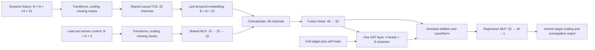

# ST-GNN architecture candidate v1

Status: candidate implemented in this package and verified with behavioural tests and a
one-epoch integration run; no full training or demonstrated research accuracy.

## Decision and relation to the proposal

Retain the proposal's two branches: a temporal encoder for dynamic features and an MLP for
slow-changing local features. Concatenate their embeddings, apply one graph attention layer,
and regress the concentration at each grid node. Start with TCN rather than introducing both
TCN and GRU implementations. Widths below are initial engineering choices, not tuned results.

Source proposal: `D:/ITB/sem 9/PPT/laporan/Tugas 2 - Kelompok 1 - Proposal Penelitian Terapan.md`,
Chapter V, Spatial Downscaling Model, lines 594–622. That document describes TCN/GRU → fusion
with static MLP → GAT → regression. It is a design source, not an implementation instruction.

The available inputs differ from the proposal:

| Aspect | Proposal | Candidate on ds-v0.1.0 |
|---|---|---|
| Prediction location | Described in terms of locations/roads | 100 m grid cell; roads receive aggregated grid predictions later |
| Graph | Road relationships | Existing bidirectional eight-neighbour grid graph |
| Dynamic sources | Macro pollution, weather, activity | GEOS-CF, Sentinel-5P, Open-Meteo, VIIRS, plus source ages |
| Local branch | Road and land attributes | Landsat NDVI/NDBI, their ages, and distance to an eligible sensor |
| Ground sensor readings | Also discussed as neighbouring inputs | Labels only; the sensor-derived predictor is distance, not concentration |
| Additional sources | AOD, MERRA-2, GPM, etc. | Not present in this feature contract; require a new feature/dataset version before use |

Do not promise improved accuracy from retaining or changing these components. The no-graph
ablation below determines whether graph attention adds value to the available features.

## Prediction task and existing data contract

Estimate the mean concentration during `[tau - 1 hour, tau)` using inputs available by `tau`.
This is estimation of a completed hour, with forecast horizon zero, not future forecasting.
The input history has exactly 24 hourly endpoints ending at `tau`.

Use `docs/experiments/ds-v0.1.0/stgnn/` without editing the frozen snapshot. The existing
`feature_matrix.prepare_stgnn.read_stgnn_batch` returns raw values, before model preprocessing.

| Raw input | Single-time batch shape | Meaning |
|---|---|---|
| `temporal` | `[N, 24, 16]` | Eleven values and five source ages |
| `land_static` | `[N, 4]` | NDVI, NDBI, and each value's age at the input cutoff |
| `sensor_static` | `[N, 1]` | Distance in metres to nearest eligible sensor |
| `edge_index` | `[2, E]` | Directed source/target indices; both directions are stored |

For the frozen graph, `N = 1044`, `E = 4654`. The network must also support other `N` and `E`.
Do not learn embeddings indexed by node ID, station UUID, or array position. Node order is an
input mapping, not a predictor. All encoders share weights across nodes.

Dynamic values, in reader order:

```text
no2_mol_m2, ntl, temperature_2m, relative_humidity_2m,
wind_speed_10m, wind_direction_10m, boundary_layer_height,
precipitation, surface_pressure, geoscf_pm25_ugm3, geoscf_no2_ugm3
```

Dynamic ages: Sentinel-5P NO2, VIIRS NTL, GEOS-CF PM2.5, GEOS-CF NO2, and weather.
Landsat is slow-changing rather than permanently static: select its values causally at each
sample's cutoff, as the reader already does. Exclude LST under the current feature contract.

Train one checkpoint per pollutant initially: PM2.5 or NO2, with scalar node output. Their
label coverage and evaluation protocols differ. Sharing labels or checkpoints across targets
requires an explicit later experiment with fold-consistent exclusions for both pollutants.

## Forward architecture

Here `B` is the number of target hours in a minibatch; `N` is the shared node count.



| Stage | Concrete starting configuration | Output |
|---|---|---|
| Dynamic preprocessing | Replace wind direction by sine/cosine; transform ages; append observed-value masks | `[B, N, 24, 34]` |
| Temporal projection | Shared linear `34 → 32` | `[B, N, 24, 32]` |
| TCN | Three residual blocks, dilations `1, 2, 4`; two Conv1d layers per block, kernel 3, channels 32, ReLU, dropout 0.1 | `[B, N, 24, 32]` |
| Temporal readout | Take last time position; no pooling across nodes | `[B, N, 32]` |
| Local preprocessing | Five values, including transformed ages/distance; append five masks | `[B, N, 10]` |
| Local encoder | Shared MLP `10 → 32 → 16`, ReLU, dropout 0.1 | `[B, N, 16]` |
| Fusion | Concatenate, linear `48 → 32`, ReLU | `[B, N, 32]` |
| Spatial encoder | One GAT layer, four heads of width 8, concatenate heads, attention dropout 0.1 | `[B, N, 32]` |
| Residual | `LayerNorm(fused + ELU(GAT(fused)))`, normalization over channels per node | `[B, N, 32]` |
| Regression head | Shared MLP `32 → 16 → 1`, ReLU hidden activation, linear final output | `[B, N, 1]` |

TCN convolutions operate on time independently for each node: reshape to `[B*N, C, L]`.
Use only left padding, `dilation * (kernel_size - 1)` per convolution, to preserve length and
causality. With two convolutions at each dilation, receptive field is
`1 + 2 * (3 - 1) * (1 + 2 + 4) = 29`, covering all 24 supplied hours. Earlier positions
outside the supplied window are padding, not additional observed history.

For graph minibatches, flatten embeddings to `[B*N, 32]` and offset a copy of `edge_index`
by `b*N` for each target hour. Never connect two time samples through graph edges. Add exactly
one self loop per node at runtime; the saved graph intentionally has none. The initial GAT
uses adjacency and node features only; attention is not a physical atmospheric transport model.

Concatenation preserves the two branches' information without forcing them into the same
representation. A learned gate, multiple alternating temporal/spatial blocks, and learned
global adjacency remain later ablations; they are not justified as the initial default.

## Preprocessing and missingness

1. Validate input column names/order against the checkpoint's feature contract. Compute a finite
   mask before imputation. Both transformed wind channels inherit the original angle's mask.
2. Replace wind direction in degrees by `sin(theta)` and `cos(theta)` in radians. This yields
   17 transformed dynamic values from 16 raw columns. Appending their masks yields 34 channels.
3. Apply `log1p` to nonnegative source ages and sensor distance in metres. Reject negative ages
   or distances as a contract error. Preserve other values linearly for the first experiment.
4. Fit mean/std on finite transformed training values only, per feature. Scale observed values;
   replace missing standardized values with zero and append masks. Masks remain 0/1 and are
   not standardized. Constant features use scale 1; all-missing training features use centre 0,
   scale 1 and are explicitly recorded as unsupported in the preprocessing artifact.
5. Transform static inputs at each sample's cutoff. Sensor distances use only the eligible
   sensor set for the fixed split or current LOSO fold. Refit sensor-distance statistics when
   the eligible sensor set changes.

Keep the original Parquet values and availability flags unchanged. Imputation occurs in the
model adapter and is recorded in its artifact. Missing ages need masks too, even though the
export does not store a separate Boolean flag for every age column.

`normalization.json` contains raw-column statistics. Do not apply its raw mean/std directly
after nonlinear transformations such as `log1p` or sine/cosine. Fit and save transformed-space
statistics from the permitted training rows, using the same training eligibility rules.
For strict unseen-location evaluation, exclude held-out groups from fitted statistics too.

Fit target mean/std on eligible training labels only. The linear head predicts standardized
concentration `z`; train against standardized labels. Inverse-transform to µg/m³, then apply
`max(0, prediction)` for evaluation and serving. Report the fraction clipped, and use exactly
the same output rule for validation, test, and deployment. Compute training loss before clipping
to avoid a dead gradient for negative predictions. This output policy is an initial choice
to check against an explicitly parameterized positive-output alternative if clipping is frequent.

## Sparse supervision and evaluation

Use finite measured labels only; do not synthesize targets for context nodes. For each sample,
gather predictions by the eligible labels' `node_index`. Multiple stations in a cell retain
their distinct label rows. The initial objective is MSE on standardized labels, averaged over
all eligible station-hour observations in the minibatch. Skip batches without eligible labels;
do not treat missing targets as zero.

The batch reader returns labels for the requested hour without filtering the protocol. The
training adapter must join their `(station_uuid, time_utc)` keys to the appropriate target and
protocol in `splits/{train,val,test}.parquet`, or to the fold's explicitly constructed key set.
The `split` column in `stgnn/labels.parquet` is PM2.5-specific; it cannot define NO2 training.
In particular, `none` labels are not automatically eligible for the fixed-split experiment.

Follow `docs/PROTOKOL_EVALUASI.md` and the frozen split files:

- PM2.5: fixed station/time split plus the prescribed grouped LOSO evaluation.
- NO2: grouped LOSO with temporal blocks; no invented independent station-validation split.
- Each held-out group is excluded from training, selection, target scaling, and sensor-derived
  features. Use the supplied LOSO distance table or recompute with eligible stations.
- Full-graph forward computation may include a held-out node's exogenous inputs, but never its
  labels or sensor-derived information. Document this graph-inclusion policy with results.
- Select configurations on validation data, never test outcomes. Retrain independently for
  each fold and seed; do not carry weights learned from a held-out group's labels between folds.

Starting training settings: AdamW, learning rate `1e-3`, weight decay `1e-4`, batch of four target
hours, maximum 200 epochs, gradient norm clipping at 1, and early stopping after 20 epochs
without validation RMSE improvement. Select the checkpoint on validation RMSE in µg/m³.
These settings are candidates, not evidence that 200 epochs are necessary. Use a small explicit
validation-only search if needed, and record its budget. Report seeds 42, 43, and 44 with variation,
rather than choosing the best test seed. Record environment, deterministic settings and any
nondeterministic graph operations; a fixed seed alone is not proof of determinism.

Compare on identical target/time/station keys with:

1. Existing IDW baseline and its validation-selected configuration.
2. TCN + local MLP + fusion + regression, with GAT removed (essential spatial ablation).
3. The complete candidate; additionally remove the local branch to assess its contribution.

Report pooled and station-level MAE, RMSE, bias, R² and sample counts, plus runtime and peak
memory. Report negative/clipped prediction rates. IDW uses contemporaneous neighbouring sensor
concentrations, whereas this candidate currently uses exogenous features and sensor distance;
make this difference in information available to each model explicit. A performance difference
alone cannot establish that graph attention or temporal convolutions caused an improvement.

## Spatial limitations and whole-city inference

Measured on the frozen snapshot: 1044 nodes, 4654 directed edges, **115 connected components**;
114 components have nine nodes and one has 18. The default graph consists almost entirely of
isolated local station patches. GAT cannot exchange information between disconnected components.
Most coarse inputs also vary little within a patch; the no-graph ablation is therefore essential.
This is a local grid model with shared weights, not evidence of learned citywide transport.

One graph layer matches the one-hop context surrounding labelled cells. Adding a second graph
layer requires a new snapshot with two-hop context if labelled-node outputs are to have complete
neighbourhoods equivalent to a full-grid graph. Context-boundary outputs should not be served
as though they had complete neighbourhoods.

Whole-city inference must build features and the same eight-neighbour grid connectivity for the
active city grid (195782 cells). The network's weights support variable graph size, but successful
extrapolation beyond sensor patches remains unproven. Use tiles with a one-hop halo for the
single GAT layer and keep only interior predictions. Preserve global grid IDs when aggregating
to roads. Temporal encoding can be chunked by node; do not change neighbourhoods to fit memory.
Measure runtime/memory on the actual deployment device before claiming feasibility.

If citywide spatial interaction is required, evaluate a deliberately new graph/dataset design
(for example local plus coarse regional connections) with new versioning. Increasing layers
alone cannot connect the current components. Do not connect distant patches arbitrarily and
claim those edges represent pollutant transport.

## Integration and artifact contract

Implementation files in this package:

```text
model.py             TCN, local encoder, fusion, GAT and regression; forward only
dataset.py           FeatureMatrix adapter, eligible label keys and graph batching
preprocessing.py     Fitted transforms, feature masks and target scaling
train.py             Optimization, selection, metrics and checkpoint writing
configs/default.toml Candidate hyperparameters and target/protocol selection
```

Suggested public forward contract:

```text
forward(temporal[B,N,24,34], local[B,N,10], edge_index[2,E])
    -> standardized_prediction[B,N,1]
```

Save weights, architecture/config version, target name/unit, input column order, transformed
column order, fitted preprocessing, graph policy, dataset checksums, training-key/fold identity,
seed, code revision, dependency versions, validation metrics, and output clipping policy as one
versioned model artifact. Register only after the required evaluation under `spatial-downscaling`.

Keep `spatial_model/inference.py` as the operational orchestrator: resolve an artifact, build
causal input histories, run preprocessing/model/inverse transform, then use the existing grid-to-road
aggregation and fallback paths. Model code does not fetch data, query databases or select aliases.
Attention weights are not uncertainty estimates. The existing confidence heuristic needs its
own calibration; it is not made statistically calibrated by adding GAT.

## Implementation verification gates

- Shapes and finite outputs for variable node counts, missing features and isolated nodes.
- Permuting node order and edge indices permutes outputs consistently.
- No graph edges connect separate minibatch hours; self loops occur once per node.
- Temporal causality: changing positions after an intermediate timestep does not change that
  timestep's encoder output. The final readout receives only the permitted 24-hour history.
- Training excludes all held-out label keys; fitted statistics and sensor distances obey folds.
- No-graph and full-model runs evaluate the same eligible observations.
- Checkpoint reload preserves predictions within the declared numerical tolerance.
- Tiled inference with the complete halo matches full-graph interior predictions in eval mode.

## Research references and scope of support

- Bai, Kolter and Koltun (2018), [An Empirical Evaluation of Generic Convolutional and Recurrent
  Networks for Sequence Modeling](https://arxiv.org/abs/1803.01271): supports TCN as a sequence
  modelling candidate; it does not establish superiority on these pollution data.
- Veličković et al. (2018), [Graph Attention Networks](https://arxiv.org/abs/1710.10903): supports
  attention over graph neighbourhoods, including inductive use; it does not validate our graph
  as a physical transport model.
- Hamilton, Ying and Leskovec (2017), [Inductive Representation Learning on Large
  Graphs](https://arxiv.org/abs/1706.02216): provides a simpler feature-based neighbourhood
  aggregation alternative (GraphSAGE) if attention does not improve validation performance.

The fusion layout, channel widths, output policy and training settings above are project design
choices to test. They are not claimed as a new method or as experimentally optimal.
